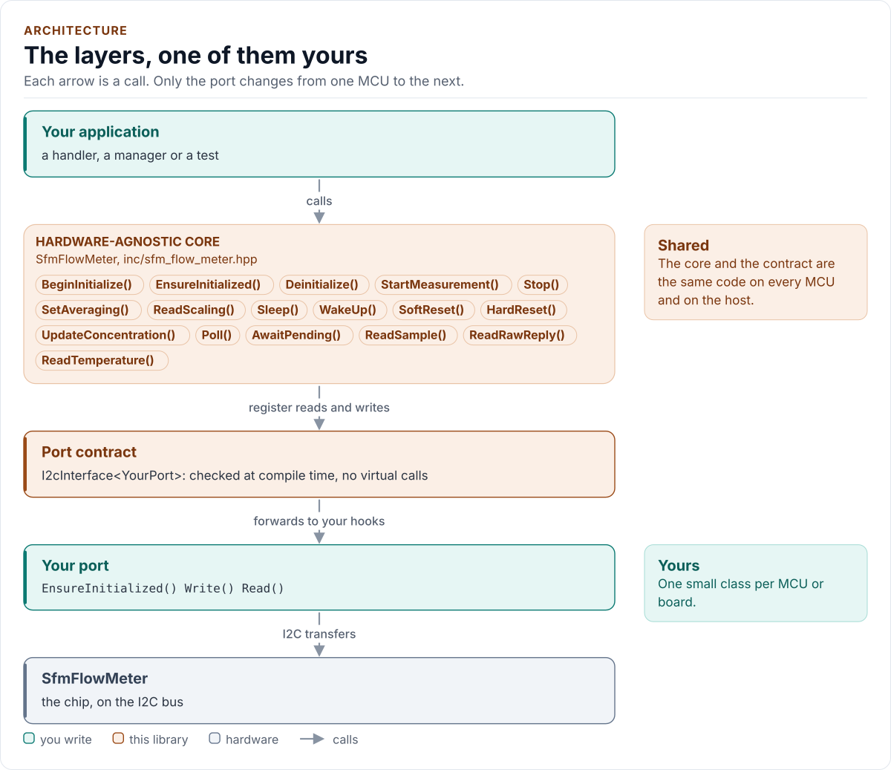
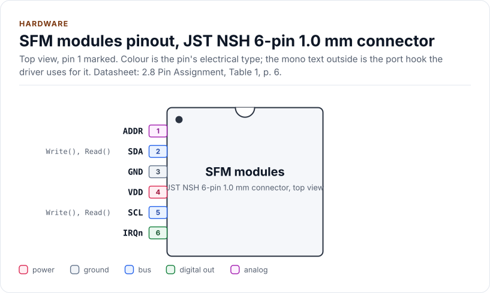
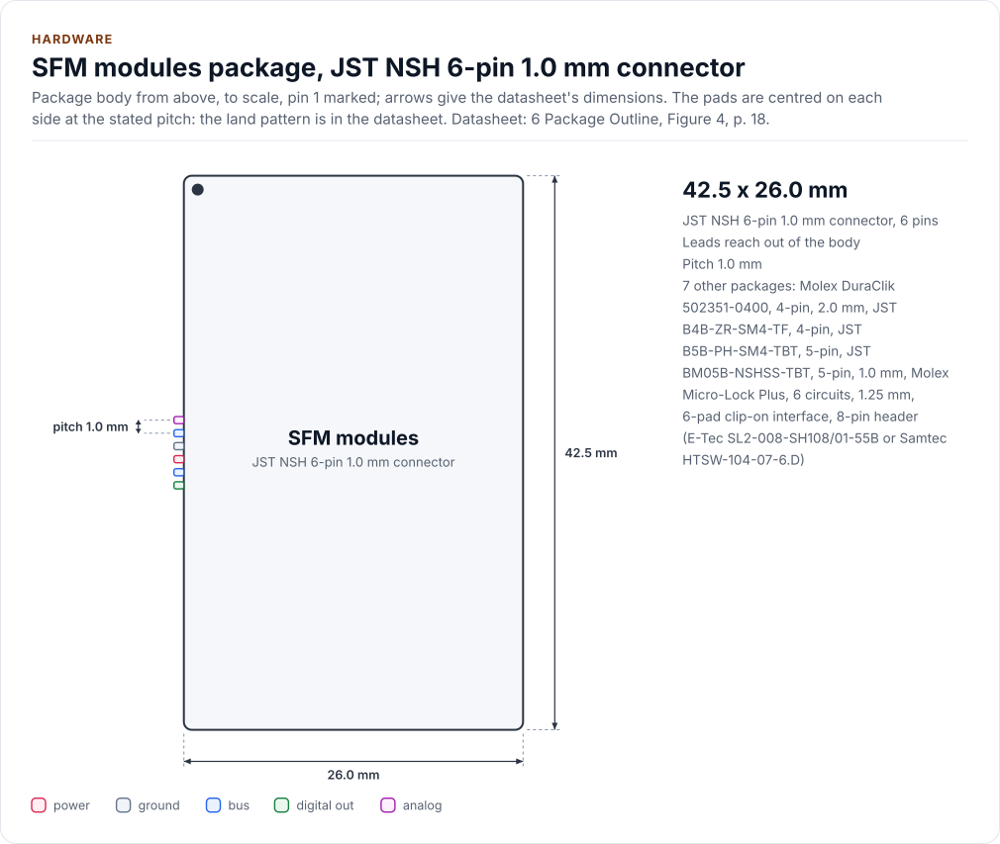
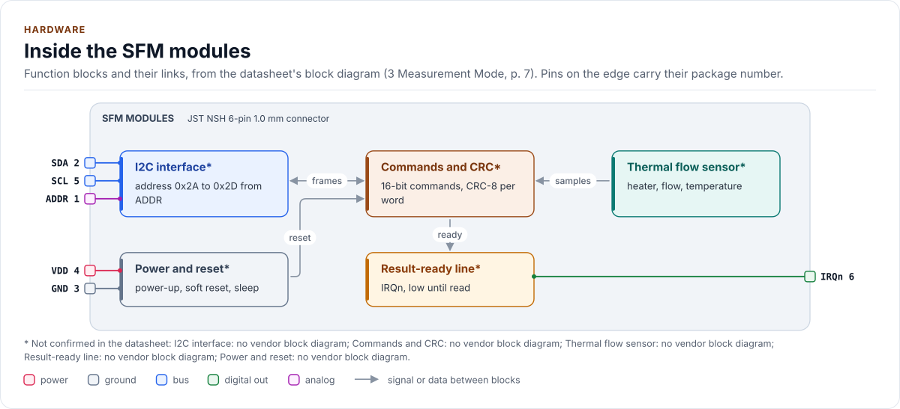

# SFM Flow Meter Driver

C++20 driver for the Sensirion SFM digital mass flow meters on I2C (SFM3000 to SFM6000D).

[](https://github.com/kokeb-labs-drivers/driver-sfm-flow-meter/actions/workflows/ci.yml)
[](LICENSE)
[](docs/installation.md#requirements)

**Documentation: [`docs/`](docs/index.md)**, with the API reference built by Doxygen ([how](docs/api-reference.md)).
The site at <https://kokeb-labs-drivers.github.io/driver-sfm-flow-meter/> opens when the repository is public.

One driver for 32 variants of the Sensirion SFM family: the SFM4300, SFM3003 (with -CET), SFM3013, SFM3019 and SFM3119,
the SFM3304, the SFM3505, the legacy SFM3000, SFM3200, SFM3300, SFM3400, SFM4200 and SFM4100, and the preliminary
SFM6000D. It identifies the part, checks the sensor's scaling against the datasheet, starts a gas or a gas mixture,
returns the flow in millilitres per minute with every word CRC-checked, and turns status words, NACKs and resets into
errors you can act on. It runs on any MCU: you give it a small class that moves bytes on your I2C bus, and it does
the rest.

> [!WARNING]
> Not a safety device, not verified on hardware. The vendor states that these sensors are not designed for
> safety-critical use unless the datasheet says so. This driver is verified against a model of the sensor only, and
> the SFM6000D protocol is preliminary. See [the contract](docs/contract.md#what-is-not-verified).

<!-- figure: driver-layers -->
<picture>
  <source media="(prefers-color-scheme: dark)" srcset="docs/diagrams/driver-layers.dark.svg">
  
</picture>
<!-- /figure -->

## At a glance

| | |
| --- | --- |
| **Sensors** | Sensirion SFM3000, SFM3200, SFM3300, SFM3400, SFM3003, SFM3013, SFM3019, SFM3119, SFM3304, SFM3505, SFM4100, SFM4200, SFM4300, SFM6000D (preliminary): 32 variants |
| **Measures** | Gas mass flow and the temperature the sensor reports (its silicon; on the SFM3003-300-CET a gas temperature sensor in the flow channel), as signed integers in millilitres per minute and milli-degrees |
| **Bus** | I2C, 100 kHz to 1 MHz by part; raw command words, 16-bit words each followed by a CRC-8 |
| **Families** | SF06 (5 parts), SF06 gen 2, SF06 dual, SF05, SF04, SFx6000 |
| **Driver** | Header-only C++20; no heap, exceptions, RTTI or virtual calls; every call returns `Result<T>`; calls that wait return the wait |
| **Runs on** | Any MCU with I2C and a C++20 compiler; the host example runs on any PC ([Platforms](docs/platforms.md)) |
| **Status** | 0.1.0, not yet verified on hardware: host-tested against a model of each variant |

The hardware is described as modules with a connector. The reference module is the SFM4300 with its six-pin
connector; the other connectors, the addresses, supply ranges and timings of every variant are on the
[Hardware page](docs/hardware.md).

<!-- figure: chip-pinout -->
<picture>
  <source media="(prefers-color-scheme: dark)" srcset="docs/diagrams/chip-pinout.dark.svg">
  
</picture>
<!-- /figure -->

<!-- figure: chip-outline -->
<picture>
  <source media="(prefers-color-scheme: dark)" srcset="docs/diagrams/chip-outline.dark.svg">
  
</picture>
<!-- /figure -->

<!-- figure: chip-blocks -->
<picture>
  <source media="(prefers-color-scheme: dark)" srcset="docs/diagrams/chip-blocks.dark.svg">
  
</picture>
<!-- /figure -->

<!-- generated: chip-card -->
| | | Datasheet |
| --- | --- | --- |
| **Package** | JST NSH 6-pin 1.0 mm connector | 2.8, [p. 6](https://sensirion.com/media/documents/024CBAA1/62987ADF/Sensirion_Datasheet_SFM4300.pdf#page=6) |
| **Pins** | 6 | 2.8, [p. 6](https://sensirion.com/media/documents/024CBAA1/62987ADF/Sensirion_Datasheet_SFM4300.pdf#page=6) |
| **Body size** | 42.5 x 26.0 mm | 6, [p. 18](https://sensirion.com/media/documents/024CBAA1/62987ADF/Sensirion_Datasheet_SFM4300.pdf#page=18) |
| **Pin pitch** | 1.0 mm | 2.8, [p. 6](https://sensirion.com/media/documents/024CBAA1/62987ADF/Sensirion_Datasheet_SFM4300.pdf#page=6) |
| **Variants** | `dura4`, `zr4`, `ph5`, `nsh5`, `mlp6`, `pad6`, `hdr8` (below) | 2.8, p. 4 |
| **Supply VDD** | 3.0 V to 5.5 V | 2.3, [p. 5](https://sensirion.com/media/documents/024CBAA1/62987ADF/Sensirion_Datasheet_SFM4300.pdf#page=5) |

Also sold as:

| Variant | Package | Pins | Size | Ordering | Note | Datasheet |
| --- | --- | --- | --- | --- | --- | --- |
| `dura4` | Molex DuraClik 502351-0400, 4-pin, 2.0 mm | 4 | - | SFM3000-200-C (order unverified), SFM3003-300-CL/-CE/-CET, SFM3013-300-CL/-CLM, SFM3019-200-CL, SFM3119-240-CL | drawing order SDA, GND, VDD, SCL; the datasheets print no pin numbers | 2.8, p. 4 |
| `zr4` | JST B4B-ZR-SM4-TF, 4-pin | 4 | - | SFM3200 | 1 SDA, 2 GND, 3 VCC, 4 SCK | Electrical connection, [p. 4](https://sensirion.com/media/documents/70FC8320/62962251/GF_DS_SFM3200.pdf#page=4) |
| `ph5` | JST B5B-PH-SM4-TBT, 5-pin | 5 | - | SFM4200 | 1 SCK, 2 VCC, 3 GND, 4 SDA, 5 /RES | Pin assignment, p. 5 |
| `nsh5` | JST BM05B-NSHSS-TBT, 5-pin, 1.0 mm | 5 | - | SFM3505-300, -300-X | 1 SDA, 2 VDD, 3 GND, 4 SCL, 5 DRDY | Pin assignment, [p. 4](https://sensirion.com/media/documents/03EE880B/68F8CF90/GF_DS_SFM3505.pdf#page=4) |
| `mlp6` | Molex Micro-Lock Plus, 6 circuits, 1.25 mm | 6 | - | SFM6000D (preliminary) | 1 VDD, 2 GND, 3 reserved, 4 SCL, 5 ADDR, 6 SDA | Pin assignment, p. 8 |
| `pad6` | 6-pad clip-on interface | 6 | - | SFM3304-250-D; SFM3200-AW, SFM3300, SFM3400 (pad names not read) | SFM3304: HEATER_GND, VDD, SCL, GND, SDA, HEATER | Pin assignment (6-pad interface), [p. 5](https://sensirion.com/media/documents/8C3FC034/6AA3DD2E/GF_DS_SFM3304-xxx-D.pdf#page=5) |
| `hdr8` | 8-pin header (E-Tec SL2-008-SH108/01-55B or Samtec HTSW-104-07-6.D) | 8 | - | SFM4100 | pin functions not read (the figure was not extracted) | 6.5, [p. 7](https://sensirion.com/media/documents/6A24D8A6/65A002E6/GF_DS_SFM4100.pdf#page=7) |

From [`docs/hardware.yml`](docs/hardware.yml); pins, circuits and the block diagram: [Hardware](docs/hardware.md).
<!-- /generated -->

## Datasheet

<!-- generated: datasheet-card -->
| Document | Revision | Get it |
| --- | --- | --- |
| Datasheet: SFM3000 digital mass flow meter (Sensirion AG SFM3000) | 2.2, July 2016 | [vendor page](https://sensirion.com/media/documents/BA2F2B48/616681DC/Sensirion_Mass_Flow_Meters_SFM3000_Datasheet.pdf) |
| Datasheet: SFM3003 digital mass flow meter (Sensirion AG SFM3003 D1) | 1.1, June 2024 | [vendor page](https://sensirion.com/media/documents/E351AEF6/66BDAB43/GF_DS_SFM3003.pdf) |
| Datasheet: SFM3003-300-CET digital mass flow meter (Sensirion AG SFM3003-300-CET) | 1.0, April 2022 | [vendor page](https://sensirion.com/media/documents/879F57CF/62975EDE/Senirion_Datasheet_SFM3003-300-CET.pdf) |
| Datasheet: SFM3013 digital mass flow meter (Sensirion AG SFM3013 D3) | 1.1, June 2024 | [vendor page](https://sensirion.com/media/documents/1018F46C/66BDAB5A/GF_DS_SFM3013.pdf) |
| Datasheet: SFM3019 digital mass flow meter (Sensirion AG SFM3019 D1) | 1.3, not printed (vendor page: 08/2024) | [vendor page](https://sensirion.com/media/documents/527C8187/6AE9A71D/Sensirion_Datasheet_SFM3019_EN.pdf) |
| Datasheet: SFM3020 analog mass flow meter (reviewed, not supported) (Sensirion AG SFM3020) | 1.2, not printed | [vendor page](https://sensirion.com/media/documents/3CBC9FC5/6AE9A6F1/Sensirion_Datasheet_SFM3020_EN.pdf) |
| Datasheet: SFM3100 analog mass flow meter (reviewed, not supported) (Sensirion AG SFM3100) | 1.5, not printed (vendor page: 08/2026) | [vendor page](https://sensirion.com/media/documents/27637785/6A71EB6F/GF_DS_SFM3100.pdf) |
| Datasheet: SFM3119 digital mass flow meter (Sensirion AG SFM3119 D1) | 1.3, September 2023 | [vendor page](https://sensirion.com/media/documents/559B741F/651C2866/GF_DS_SFM3119_v1_3.pdf) |
| Datasheet: SFM3200 digital mass flow meter (Sensirion AG SFM3200) | 1.1, May 2017 | [PDF](https://sensirion.com/media/documents/70FC8320/62962251/GF_DS_SFM3200.pdf) · [vendor page](https://sensirion.com/media/documents/70FC8320/62962251/GF_DS_SFM3200.pdf) |
| Datasheet: SFM3200-AW digital mass flow meter (Sensirion AG SFM3200-AW) | 1.1, March 2022 | [vendor page](https://sensirion.com/media/documents/CF8EB396/62D12B6B/Sensirion_Datasheet_SFM3200-AW.pdf) |
| Datasheet: SFM3300-D and SFM3300-AW digital mass flow meters (Sensirion AG SFM3300) | 1.4, March 2022 | [vendor page](https://sensirion.com/media/documents/8ECF0D28/62D13110/Sensirion_Datasheet_SFM3300-AW_SFM3300-D.pdf) |
| Datasheet: SFM3304-xxx-D digital mass flow meter (Sensirion AG SFM3304) | 1.3, not printed (vendor page: 09/2026) | [PDF](https://sensirion.com/media/documents/8C3FC034/6AA3DD2E/GF_DS_SFM3304-xxx-D.pdf) · [vendor page](https://sensirion.com/media/documents/8C3FC034/6AA3DD2E/GF_DS_SFM3304-xxx-D.pdf) |
| Application note: Transition guide SFM3300-250-D to SFM3304-250-D (Sensirion AG SFM3300-SFM3304 transition) | 1, not printed (vendor page: 10/2026) | [vendor page](https://sensirion.com/media/documents/194FE050/6AE46AF4/Sensirion_application_note_transition_guide_GF_AN_SFM3300_SFM3304_EN.pdf) |
| Datasheet: SFM3400-AW and SFM3400-D digital mass flow meters (Sensirion AG SFM3400) | 1.5, January 2024 | [vendor page](https://sensirion.com/media/documents/9EE7E5FF/659D365C/GF_DS_SFM3400AW_SFM3400D.pdf) |
| Datasheet: SFM3505 digital mass flow meter (Sensirion AG SFM3505 D3) | 1.0, October 2025 | [PDF](https://sensirion.com/media/documents/03EE880B/68F8CF90/GF_DS_SFM3505.pdf) · [vendor page](https://sensirion.com/media/documents/03EE880B/68F8CF90/GF_DS_SFM3505.pdf) |
| Datasheet: SFM4100 series digital mass flow meters (Sensirion AG SFM4100) | 1.4, January 2024 | [PDF](https://sensirion.com/media/documents/6A24D8A6/65A002E6/GF_DS_SFM4100.pdf) · [vendor page](https://sensirion.com/media/documents/6A24D8A6/65A002E6/GF_DS_SFM4100.pdf) |
| Application note: CRC calculation for the SFM4100 (Sensirion AG SFM4100 CRC) | 1.0, June 2009 | [PDF](https://sensirion.com/media/documents/FA1A9B3B/6165B558/Sensirion_Mass_Flow_Meters_CRC_Calculation_V1_1.pdf) · [vendor page](https://sensirion.com/media/documents/FA1A9B3B/6165B558/Sensirion_Mass_Flow_Meters_CRC_Calculation_V1_1.pdf) |
| Application note: SFM4100 sample code (Sensirion AG SFM4100 sample code) | 1.0, July 2009 | [vendor page](https://sensirion.com/media/documents/4E4E4F83/617C06E2/Sensirion_Mass_Flow_Meters_Software_SFM4100_Sample_Code.pdf) |
| Datasheet: SFM4200 digital mass flow meter (Sensirion AG SFM4200 D1) | 1.2, August 2018 | [vendor page](https://sensirion.com/media/documents/7AA39BF4/65436B98/GF_DS_SFM4200-v1.2-D1.pdf) |
| Datasheet: SFM4300 series digital mass flow meters (Sensirion AG SFM4300 D1) | 1.0, April 2022 | [PDF](https://sensirion.com/media/documents/024CBAA1/62987ADF/Sensirion_Datasheet_SFM4300.pdf) · [vendor page](https://sensirion.com/media/documents/024CBAA1/62987ADF/Sensirion_Datasheet_SFM4300.pdf) |
| Datasheet: SFC5300 and SFM5300 (2016; reviewed, not supported) (Sensirion AG SFM5300 (2016)) | not printed, 2016 | [vendor page](https://sensirion.com/media/documents/58AAFA86/61668D0A/Sensirion_Mass_Flow_Meters_SFM5300_Datasheet.pdf) |
| Datasheet: SFC5300/SFM5300 and SFC5330/SFM5330 (reviewed, not supported) (Sensirion AG SFx53x0) | 05/2023, May 2023 | [vendor page](https://sensirion.com/media/documents/3B14FBDD/645220AD/GF_DS_SFC53x0_SFM53x0.pdf) |
| Datasheet: SFC5400 and SFM5400 (reviewed, not supported) (Sensirion AG SFx5400) | 05/2023, May 2023 | [vendor page](https://sensirion.com/media/documents/AF658E7B/645221C1/GF_DS_SFC5400_SFM5400.pdf) |
| Datasheet: SFC5460 and SFM5460 (reviewed, not supported) (Sensirion AG SFx5460) | 05/2023, May 2023 | [vendor page](https://sensirion.com/media/documents/68F6FE26/64522277/GF_DS_SFC5460_SFM5460.pdf) |
| Datasheet: SFC5500 and SFM5500 (reviewed, not supported) (Sensirion AG SFx5500) | 02/2024, February 2024 | [vendor page](https://sensirion.com/media/documents/92E99F10/65CDCACE/GF_DS_SFC5500_SFM5500_003.pdf) |
| Reference manual: SFC5xxx SHDLC interface reference (reviewed, not supported) (Sensirion AG SFC5xxx SHDLC) | 1.9, October 2015 | [vendor page](https://sensirion.com/media/documents/B3F417D2/61F8E792/GF_AN_SFC5xxx_ShdlcInterfaceReference_V1_9_D1.pdf) |
| Datasheet: SFC6000D and SFM6000D digital mass flow meters (Sensirion AG SFx6000D D1) | 1.1, May 2023 | [vendor page](https://sensirion.com/media/documents/442A3611/64958B2C/DS_SFC6000D_SFM6000D.pdf) |
| Reference manual: SFC6xxx/SFM6xxx I2C interface reference (preliminary) (Sensirion AG SFx6000 I2C) | 1.1, not printed (vendor page: 07/2023) | [PDF](https://sensirion.com/media/documents/3D857436/65156AC0/GF_AN_SFC6xxx_I2C_InterfaceReference1.1.pdf) · [vendor page](https://sensirion.com/media/documents/3D857436/65156AC0/GF_AN_SFC6xxx_I2C_InterfaceReference1.1.pdf) |
| Reference manual: SFC6xxx/SFM6xxx RS485 SHDLC guide (reviewed, not supported) (Sensirion AG SFx6000 SHDLC) | 1.1, not printed | [vendor page](https://sensirion.com/media/documents/88CA2961/65156AEC/GF_AN_SFX6000_SHDLCGuide1.1.pdf) |
| Application note: SFM-05 I2C functional description for the SFM3x00 series (Sensirion AG SFM-05) | not printed (vendor page: 10/2026), not printed | [PDF](https://sensirion.com/media/documents/BE7405C4/6AC34DFB/GF_AN_SFM-05_I2C_Functional_Description.pdf) · [vendor page](https://sensirion.com/media/documents/BE7405C4/6AC34DFB/GF_AN_SFM-05_I2C_Functional_Description.pdf) |
| Application note: SFM-04 CRC checksum (Sensirion AG SFM-04 D1) | not printed, not printed (vendor page: 01/2020) | [vendor page](https://sensirion.com/media/documents/1E3CD1FF/6165AFE4/Sensirion_GF_AN_SFM-04_CRC_Checksum_D1.pdf) |
| Application note: SFM-01 engineering guidelines for mass flow meters (Sensirion AG SFM-01) | not printed, not printed | [vendor page](https://sensirion.com/media/documents/1DDDD810/61669D98/Sensirion_GF_AN_SFM-01_Engineering_Guidelines_For_Mass_Flow_Meters_D.pdf) |

Written against these revisions; the SHA-256 of each file is in [`docs/datasheets.yml`](docs/datasheets.yml). Where each
part of the driver is in the datasheet: [Datasheet map](docs/datasheet.md).
<!-- /generated -->

Every docs page lists the datasheet sections it relies on, and code comments cite the section they implement.

## Try it on your PC

No hardware needed: [`examples/host`](examples/host/README.md) runs the driver against a simulated sensor. You need git,
CMake 3.16+ and a C++20 compiler (GCC 10+, Clang 13+ or MSVC 2022).

1. Get the source:

   ```bash
   git clone https://github.com/kokeb-labs-drivers/driver-sfm-flow-meter.git && cd driver-sfm-flow-meter
   ```

2. Build and run the example:

   ```bash
   cmake -S examples/host -B build-example
   cmake --build build-example
   ./build-example/sfm_flow_meter_host_example
   ```

3. You should see three scenarios run against simulated sensors and the line `all scenarios passed`.

To run the whole test suite instead: `cmake -S . -B build -DSFM_FLOW_METER_BUILD_TESTS=ON && cmake --build build &&
ctest
--test-dir build`.

## Use it on your MCU

**1. Wire it** ([Hardware](docs/hardware.md) has every connector, the supply of each part and the timing):

| MCU | Sensor | Notes |
| --- | --- | --- |
| I2C SDA | SDA | External pull-up to the bus voltage |
| I2C SCL | SCL | External pull-up to the bus voltage |
| 3.3 V or 5 V | VDD | By part: SFM3000, 3200, 3300, 3400, 4200 need 5 V; SFM4100 3.5 V to 9 V; SFM4300, SFM3xxx 3.3 V or 5 V |
| GND | GND | |

**2. Write the port**: a class with `EnsureInitialized()` (bring the bus up), `Write()` and `Read()` (one I2C
transaction each) and, for the blocking calls, `DelayUs()`; about 20 lines on most SDKs. [Porting](docs/porting.md) has
the
contract of every hook and a complete example.

**3. Read the flow:**

<!-- generated: quickstart-code -->
```cpp
#include "sfm_flow_meter.hpp"

bool ReadOnce(MyPort& port) {
  sfm::SfmFlowMeter<MyPort> meter(
      port, sfm::PresetFor(sfm::Variant::SFM3003_300_CL)); // no bus traffic yet

  if (!meter.EnsureInitialized()) { // wakes the sensor, checks the product identifier
    return false;
  }
  if (!meter.StartMeasurement(sfm::Gas::Air)) { // reads and checks the scaling, then starts
    return false;
  }
  if (!meter.AwaitPending()) { // the first sample is ready after the start wait
    return false;
  }
  const sfm::Result<sfm::Sample> s = meter.ReadSample();
  if (!s) {
    return false; // s.error says why: NoData, Crc, DeviceReset, ...
  }
  app::Report(s.value.flow_ml_per_min, s.value.temperature_mdegc);
  return meter.Stop().ok() && meter.AwaitPending().ok();
}
```
<!-- /generated -->

`EnsureInitialized()` is the only call that starts the sensor. Every other call returns `Error::NotInitialized` until
it has succeeded, and no read ever starts the sensor on its own. A read that returns `Error::NoData` is not a fault:
the sensor has no new sample yet.

## What it does

- Identifies the part by its product identifier (or serial number) and refuses a different part.
- Reads the sensor's scale factor, offset and unit before every start and compares them with the datasheet.
- Starts a pure gas or an air and oxygen mixture, updates the mixture while measuring, sets the averaging, and
  puts the sensor to sleep and wakes it.
- Checks the CRC-8 of every word before it decodes anything, checks the status word, the range and the freshness of
  every sample, and treats a stuck line as an error.
- Notices a sensor that reset or disappeared, and reports the legacy parts' error limit as `StateUnknown` and
  recovers them with `HardReset()`.
- Returns `Result<T>` from every call: no exceptions, no heap, no RTTI, no virtual calls.

## Add it to your project

Pick the row that matches your build; each is a few steps, and [Installation](docs/installation.md) has the
details.

| Your build | Steps below |
| --- | --- |
| Plain CMake: STM32 (CubeMX), RP2040 (Pico SDK), nRF Connect, a host app | [A](#a-cmake-any-mcu) |
| ESP-IDF | [B](#b-esp-idf) |
| An SDK or OS image that installs libraries | [C](#c-installed-package) |

### A. CMake, any MCU

1. Add the driver as a submodule, pinned to the version you chose:

   ```bash
   git submodule add https://github.com/kokeb-labs-drivers/driver-sfm-flow-meter.git external/driver-sfm-flow-meter
   ```

2. In your `CMakeLists.txt`, after `project()`:

   ```cmake
   add_subdirectory(external/driver-sfm-flow-meter)
   target_link_libraries(my_app PRIVATE sfm_flow_meter::sfm_flow_meter)   # brings the headers and C++20
   ```

3. In your code, `#include "sfm_flow_meter.hpp"`, write the port ([Porting](docs/porting.md)) and build. A first build
   that compiles the quickstart above is the check that the driver is wired in.

### B. ESP-IDF

1. Add the driver under your project's `components/`; ESP-IDF finds it there and names it after the folder:

   ```bash
   git submodule add https://github.com/kokeb-labs-drivers/driver-sfm-flow-meter.git components/sfm_flow_meter
   ```

2. In `main/CMakeLists.txt`, list it: `idf_component_register(SRCS "main.cpp" REQUIRES sfm_flow_meter)`.
3. `idf.py menuconfig` now has an **SFM flow meter driver** menu (averaging, scaling check, range flag, timing),
   and `idf.py build` builds the driver with your app. [`examples/esp32`](examples/esp32) is a complete
   project with a port for the board.

### C. Installed package

1. Install it once into a prefix:

   ```bash
   cmake -S external/driver-sfm-flow-meter -B build-sfm_flow_meter && cmake --install build-sfm_flow_meter --prefix /opt/sdk
   ```

2. In your project, with `CMAKE_PREFIX_PATH=/opt/sdk`:

   ```cmake
   find_package(sfm_flow_meter 0.1 REQUIRED)
   target_link_libraries(my_app PRIVATE sfm_flow_meter::sfm_flow_meter)
   ```

The target is `sfm_flow_meter::sfm_flow_meter` every way, so switching later changes nothing else.

## Documentation

| Page | Read it when you want to |
| --- | --- |
| [Quickstart](docs/quickstart.md) | Go from a bare sensor to a flow on your MCU |
| [Hardware](docs/hardware.md) | Connectors, addresses, supply, bus settings, timing, fittings per variant |
| [Porting](docs/porting.md) | Write the port class for your MCU's SDK |
| [API guide](docs/api-guide.md) | Use each call: start, measure, update a mixture, sleep, reset, handle errors |
| [Configuration](docs/configuration.md) | Choose every setting, or start from a preset |
| [Troubleshooting](docs/troubleshooting.md) | Find the cause of an error or a wrong reading |
| [Contract](docs/contract.md) | Know what the driver promises, needs and returns, and what is not verified |
| [Datasheet map](docs/datasheet.md) | Find the datasheet section behind each part of the driver |
| [API reference](docs/api-reference.md) | Look up a class or member (Doxygen; built by CI and locally) |

## Tests and quality

```bash
cmake -S . -B build -DSFM_FLOW_METER_BUILD_TESTS=ON && cmake --build build && ctest --test-dir build
```

The host tests run every variant against an independent model of the sensor, fail every bus transfer in turn, and
produce each error the driver can return. A fuzzer fails, corrupts and replaces what the sensor sends back and checks
the driver's promises after every call. CI also builds for Cortex-M and gates coverage, complexity, sanitizers,
fuzzing, clang-tidy, cppcheck and the handbook rules (`.kokeb/handbook.yml`). See [Testing and CI](docs/testing.md),
which lists every gate and its limit.

## License

MIT. See [LICENSE](LICENSE).
