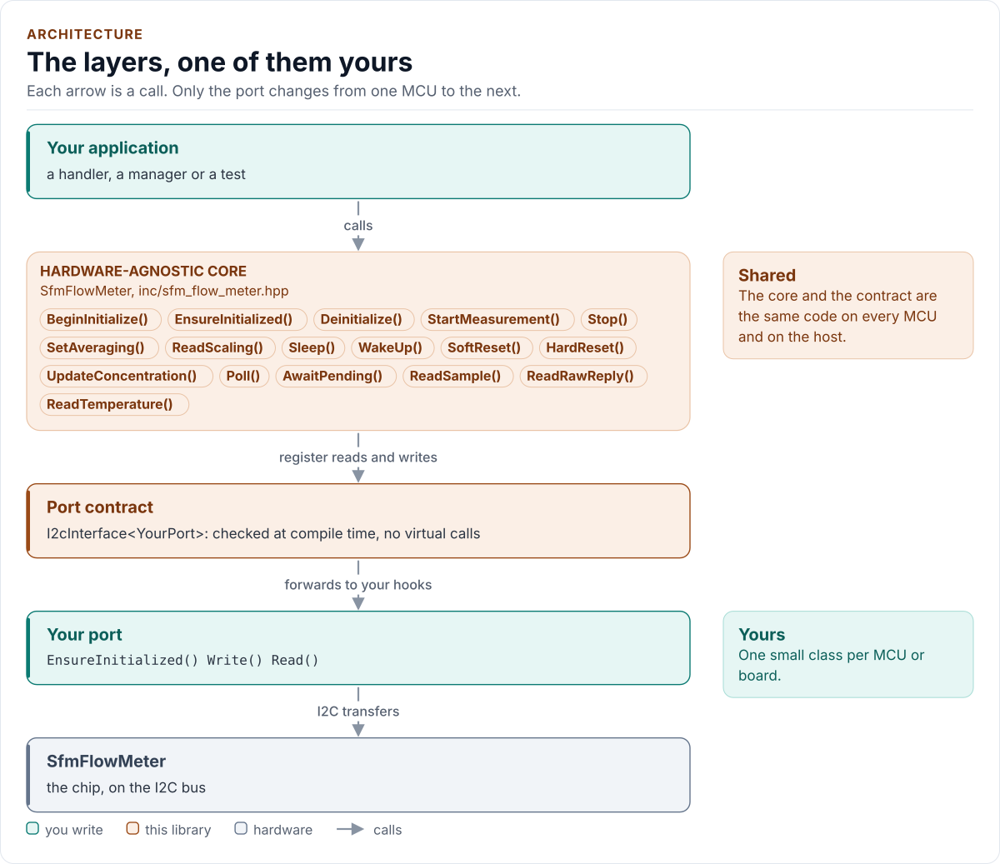
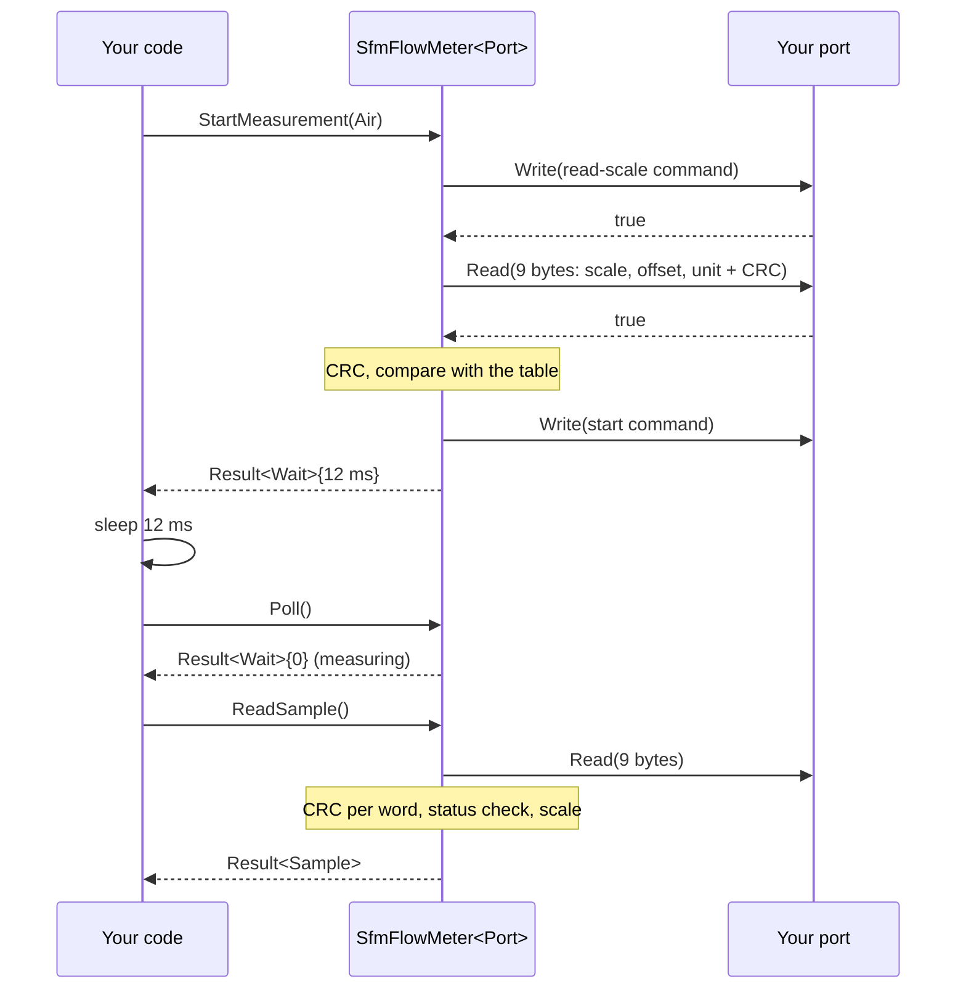
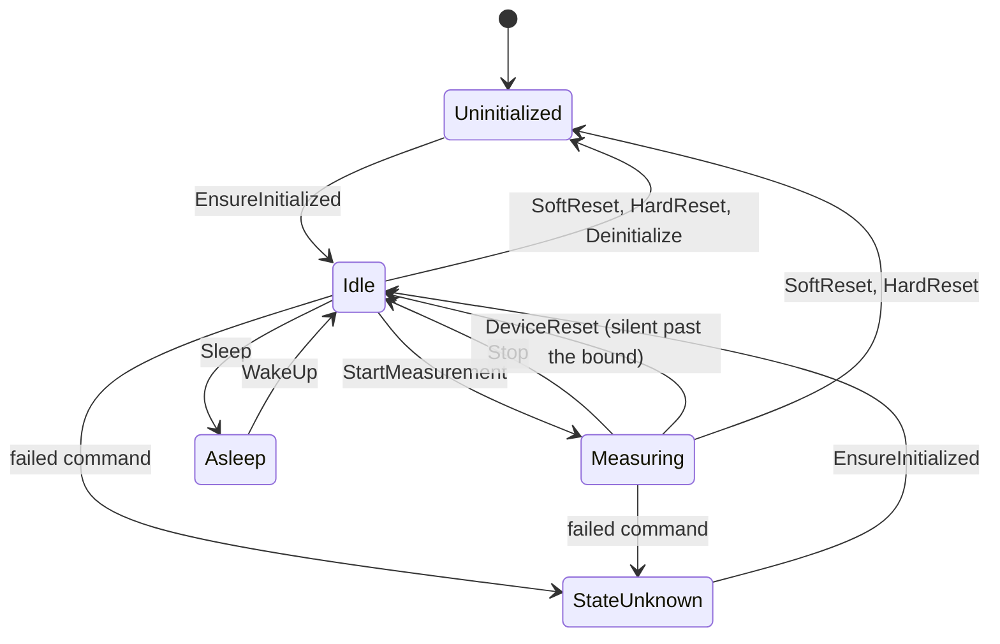

# Architecture

How the driver is built: one driver for six protocol families, parts as data, an executor that turns each call into a
short plan of bus steps, and the state machine that keeps the driver's picture of the sensor honest.

<!-- generated: datasheet-refs -->
??? abstract "Datasheet sections this page relies on"

    - Sf05 reset, restart and first read: Sensirion AG SFM3200 1.1, Digital interface (soft reset 80 ms, restart before read), [p. 5](https://sensirion.com/media/documents/70FC8320/62962251/GF_DS_SFM3200.pdf#page=5)
    - Gen2 start with a filter argument and its status layout: Sensirion AG SFM3304 1.3, Digital interface description (start 0x3603 with filter, status word), [p. 11](https://sensirion.com/media/documents/8C3FC034/6AA3DD2E/GF_DS_SFM3304-xxx-D.pdf#page=11)
    - Dual-gas frame of 24 bits: Sensirion AG SFM3505 D3 1.0, Digital interface description (24-bit frame, commands), [p. 10](https://sensirion.com/media/documents/03EE880B/68F8CF90/GF_DS_SFM3505.pdf#page=10)
    - Sf04 trigger bytes and the hold-master read: Sensirion AG SFM4100 1.4, Digital interface (trigger, clock stretching, address per gas), [p. 4](https://sensirion.com/media/documents/6A24D8A6/65A002E6/GF_DS_SFM4100.pdf#page=4)
    - Timing (reset, first sample, wake-up, stop): Sensirion AG SFM4300 D1 1.0, 2.4 Timing specification, [p. 5](https://sensirion.com/media/documents/024CBAA1/62987ADF/Sensirion_Datasheet_SFM4300.pdf#page=5)
    - IRQn and start-up behaviour: Sensirion AG SFM4300 D1 1.0, 3.2 Sensor start-up and warm-up; 3.3 IRQn, [p. 8](https://sensirion.com/media/documents/024CBAA1/62987ADF/Sensirion_Datasheet_SFM4300.pdf#page=8)
    - I2C address and bus: Sensirion AG SFM4300 D1 1.0, 4 Digital interface description; 4.1 I2C address, [p. 9](https://sensirion.com/media/documents/024CBAA1/62987ADF/Sensirion_Datasheet_SFM4300.pdf#page=9)
    - Command framing and read framing: Sensirion AG SFM4300 D1 1.0, 4.2 I2C sequences, [p. 9](https://sensirion.com/media/documents/024CBAA1/62987ADF/Sensirion_Datasheet_SFM4300.pdf#page=9)
    - Start measurement, results and the NACK of a read without data: Sensirion AG SFM4300 D1 1.0, 4.3.1 Start continuous measurement, [p. 10](https://sensirion.com/media/documents/024CBAA1/62987ADF/Sensirion_Datasheet_SFM4300.pdf#page=10)
    - Stop measurement: Sensirion AG SFM4300 D1 1.0, 4.3.4 Stop continuous measurement, [p. 12](https://sensirion.com/media/documents/024CBAA1/62987ADF/Sensirion_Datasheet_SFM4300.pdf#page=12)
    - Sleep and wake-up: Sensirion AG SFM4300 D1 1.0, 4.3.8 Entering and exiting sleep mode, [p. 14](https://sensirion.com/media/documents/024CBAA1/62987ADF/Sensirion_Datasheet_SFM4300.pdf#page=14)
    - Legacy command set with pointer registers (Sf05): Sensirion AG SFM-05 not printed (vendor page: 10/2026), I2C functional description (commands, EEPROM, serial, CRC), [p. 4](https://sensirion.com/media/documents/BE7405C4/6AC34DFB/GF_AN_SFM-05_I2C_Functional_Description.pdf#page=4)

    All of them, with the driver API for each: [Datasheet map](datasheet.md).
<!-- /generated -->

<!-- figure: driver-layers -->
<picture>
  <source media="(prefers-color-scheme: dark)" srcset="diagrams/driver-layers.dark.svg">
  
</picture>
<!-- /figure -->

## Layers

| Layer | Files | Owns |
| --- | --- | --- |
| Core | [`inc/sfm_flow_meter.hpp`](../inc/sfm_flow_meter.hpp), [`src/sfm_flow_meter.ipp`](../src/sfm_flow_meter.ipp) | The public calls, the state machine, the executor, decoding checks |
| Protocols | [`inc/sfm_flow_meter_protocols.hpp`](../inc/sfm_flow_meter_protocols.hpp) | Per-family plans and decoders: pure functions of the part row and the request |
| Parts | [`inc/sfm_flow_meter_parts.hpp`](../inc/sfm_flow_meter_parts.hpp) | The table of 32 `PartInfo` rows, `PresetFor()`, `Validate()`, `CheckedConfig` |
| Types and codes | [`inc/sfm_flow_meter_types.hpp`](../inc/sfm_flow_meter_types.hpp), [`inc/sfm_flow_meter_registers.hpp`](../inc/sfm_flow_meter_registers.hpp) | `Error`, `Result<T>`, `Config`, `Sample`; command and pointer codes, CRC-8 |
| Port contract | [`inc/sfm_flow_meter_i2c_interface.hpp`](../inc/sfm_flow_meter_i2c_interface.hpp) | The CRTP base, the `I2cPort` concept, the bus requirements |
| Platform port | Your class | Bus bring-up and byte transfers; optionally delay, clock, log, stretching read, general call, power and reset pins |
| Kconfig layer | [`inc/sfm_flow_meter_kconfig.hpp`](../inc/sfm_flow_meter_kconfig.hpp) | Optional: a `Config` from ESP-IDF menuconfig |

## One driver, six families, parts as data

The 32 supported variants fall into six command-set families. `SfmFlowMeter<Port, FamilyMask>` dispatches on
`PartInfo::family` and on the row's feature bits, never on the variant, so adding a part is a table row. The family
mask limits which families an object may drive; a smaller mask lets the compiler drop the rest, and a
configuration outside the mask is `Unsupported`.

| Family | Parts | What differs |
| --- | --- | --- |
| `Sf06` | SFM4300, SFM3003, -CET, SFM3013, SFM3019, SFM3119 | 16-bit commands, 9-byte frame (flow, temperature, status), CRC init 0xFF |
| `Sf06Gen2` | SFM3304 | SF06 framing; one gas, optional filter argument, status with the averaging flags |
| `Sf06Dual` | SFM3505 | Two 24-bit flows in a frame; no scale read, no status word |
| `Sf05` | SFM3000, 3200, 3300, 3400, 4200 | Pointer registers, EEPROM scale, CRC init 0x00, restart before read, 5 V |
| `Sf04` | SFM4100 | 8-bit commands, clock-stretching read, one gas per address |
| `Sfx6000` | SFM6000D | Preliminary vendor protocol, every fact tagged `[P]` |

A row of `PartInfo` holds the product identifier and its mask, the address set, the CRC init, the gas rows (start
code, status index, scale, offset, unit), the span, the temperature scaling, the timing, the feature bits, the
clock limit and the supply range. The tests type their expectations again by hand from the datasheets and compare
them with the table, so a typo in the table fails a test.

## The executor: plans and steps

A call does not talk to the bus itself. It builds a request, asks the protocol layer for a `Plan` of at most ten
steps, and the executor runs it. The step kinds are `Write`, `Poll`, `Read`, `ReadStretch`, `GeneralCall`, `Wait`,
`ResetPin` and `PowerCycle`.

- A `Write` or a `Read` is one bus transfer through the port. A `Poll` repeats the next real command of the family
  (the stop command, the SF05 serial pointer, the SF04 register read) every millisecond until the sensor acknowledges
  it or a bound is reached (every loop has a bound). The driver never sends an empty transfer; a NACK on a poll is
  what a sleeping or resetting sensor answers by design and is not counted as a bus error.
- A `Wait` returns control to the caller as a `Wait{us}`; nothing in the driver sleeps. The blocking calls are
  `AwaitPending()` over `DelayUs()`.
- Operations with phases (initialise 2, start 3, read scaling 2, wake 2) build the next plan from the decoded result of
  the previous one, because what comes next depends on what the sensor said.
- Every read is a multiple of three bytes. `ParseWords()` checks the CRC of each word before any value is decoded or
  stored, and one bad word discards the whole transfer.

## State machine

| State | Calls that send traffic | Refused (nothing sent) |
| --- | --- | --- |
| `Uninitialized` | `BeginInitialize()`, `EnsureInitialized()`, `SoftReset()` where the part supports it | everything else: `NotInitialized` |
| `Idle` | `StartMeasurement()`, `SetAveraging()`, `ReadScaling()`, `Sleep()`, `SoftReset()`, `HardReset()` | `ReadSample()`, `UpdateConcentration()`: `Busy` |
| `Measuring` | `ReadSample()`, `ReadTemperature()`, `UpdateConcentration()`, `Stop()`, `SoftReset()` | `SetAveraging()`, `ReadScaling()`, `Sleep()`, a second start: `Busy` |
| `Asleep` | `WakeUp()` | everything else: `Busy` |
| `StateUnknown` | `EnsureInitialized()`, `SoftReset()`, `HardReset()` | everything else: `StateUnknown` |

A failed `Stop`, `Sleep`, reset, concentration update or the launch phase of a start leaves `StateUnknown`: the
datasheets do not say whether a NACKed command took effect (K-CMDECHO), so the driver does not guess. A failed
`ReadTemperature()` does so only when the pointer moved and was not restored. While an operation is pending (a wait
was returned) every other call is `Busy`; `Poll()` continues it. A successful soft or hard reset leaves
`Uninitialized`, because the sensor lost its averaging and its mode.

## Device-loss detection

A read that finds no new sample is NACKed by design (SFM4300 3.3): the sensor makes a result every N x 0.5 ms for an
averaging of N, so with N = 128 a fast loop meets a NACK on most reads. `ReadSample()` returns `NoData` for it and
changes nothing. Only a silence longer than the datasheet bound decides anything: the time to the first result plus
one averaged period (10 % margin) plus 1 ms, measured from the last reply frame the sensor delivered (from the start
of the measurement before the first one). A frame counts even when a check rejects it (range, CRC, status) and so does
a raw read: a sensor that delivers is not silent. Without a clock the driver never decides: a count of NACKed reads
says nothing about time, so the caller times the silence and calls `Stop()`. After the bound the driver asks with the
next real command (the stop command for the SF06 families, the pointer to the serial number for the SF05, never an
empty write): no acknowledgement is `NoDevice`; an acknowledgement means the sensor is alive and now idle (it was
reset, or it has just been told to stop), so the driver goes to `Idle`, returns `DeviceReset` and holds the next
command for the stop time (`Busy` for 0.5 ms). A single transient NACK that arrives after the caller has been away for
longer than the bound cannot be told from silence, so it is confirmed the same way (the measurement ends and the
caller starts it again). It never restarts the measurement itself, because a restart changes the gas table and the
decision is the caller's. The SF05 family also counts errors in a row, because a NACK there can mean a lock-up; at the
limit the state is `StateUnknown` and the caller runs `HardReset()`, so a read never power cycles on its own. SF04 has
no continuous mode and no `NoData`.

## Design choices

- **CRTP, not virtual functions.** The port is a template parameter constrained by the `I2cPort` concept, so every
  call is resolved at compile time and a missing hook is a compile error that names it.
- **Optional hooks by `requires`.** `DelayUs`, `NowUs`, `Log`, `ReadStretch`, `WriteGeneralCall`, `PowerCycle` and
  `SetResetPin` are detected with C++20 `requires`. A hook declared with the wrong signature fails the build.
- **Pure plans and decoders.** The protocol layer has no state and no port, so it is tested alone and a decoder can run
  in an interrupt handler on bytes it was given.
- **No I/O in the constructor.** Construction cannot fail, so the driver can be a static or a member of a handler.
- **One error type.** `Result<T>` carries a value and an `Error`; nothing throws and nothing returns a bare `bool`.
- **No heap, no exceptions, no RTTI, no `std::function`, no `printf`.** The driver is a header-only template with no
  mutable static state.

## Source map

| You want | Read |
| --- | --- |
| The public API | [`inc/sfm_flow_meter.hpp`](../inc/sfm_flow_meter.hpp) |
| How a call is implemented | [`src/sfm_flow_meter.ipp`](../src/sfm_flow_meter.ipp) |
| The sequences of each family | [`inc/sfm_flow_meter_protocols.hpp`](../inc/sfm_flow_meter_protocols.hpp) |
| The parts | [`inc/sfm_flow_meter_parts.hpp`](../inc/sfm_flow_meter_parts.hpp) |
| Command codes and the CRC | [`inc/sfm_flow_meter_registers.hpp`](../inc/sfm_flow_meter_registers.hpp) |
| The port contract | [`inc/sfm_flow_meter_i2c_interface.hpp`](../inc/sfm_flow_meter_i2c_interface.hpp) |

Next: [Contract](contract.md).
