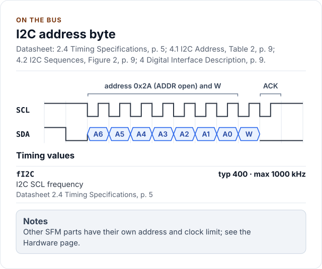
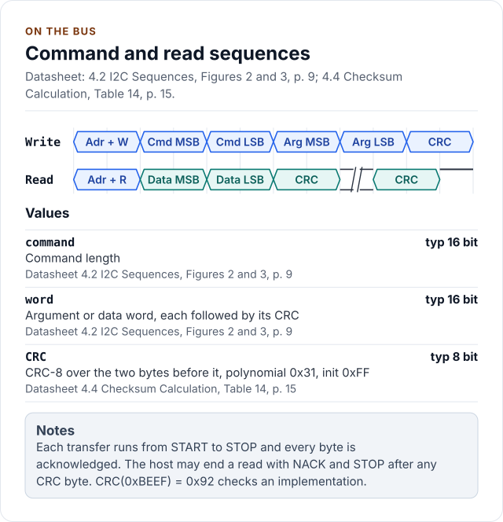
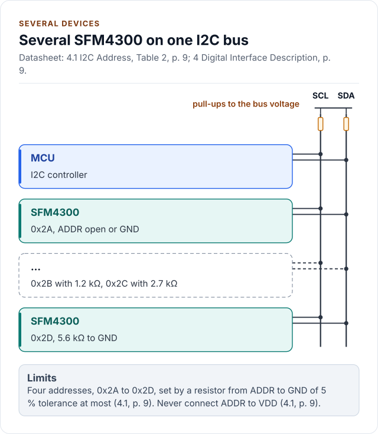

# On the bus

What an SFM flow meter needs from the I2C bus, with every rate and limit taken from the data sheet. The figures use
the SFM4300 (D1, v1.0), the part the driver's documentation follows; the other SF06 parts repeat its sequences, and
the address and clock limit of every part are on the [Hardware](hardware.md#bus-settings) page.

## I2C timing

The SFM4300 runs its I2C clock at 400 kHz typical and 1 MHz at most (section 2.4); the driver's limit is
`kMaxClockHz` and a part's own is `PartInfo::max_clock_hz`. SDA and SCL need pull-ups to the bus voltage (section 4).
The data sheet gives no I2C timing table of its own and refers to the I2C-bus specification for every interval, so the
figure draws the address byte and the clock the data sheet states.

<!-- figure: i2c-timing -->
<picture>
  <source media="(prefers-color-scheme: dark)" srcset="diagrams/i2c-timing.dark.svg">
  
</picture>
<!-- /figure -->

## Command and read sequences

Every command is 16 bits; a command with an argument adds a 16-bit argument and its CRC byte. The sensor answers a
read with 16-bit words, each followed by a CRC-8 over its two bytes (polynomial 0x31, initial value 0xFF), and the host
may stop after any CRC with NACK and STOP (sections 4.2 and 4.4). The driver checks every CRC (`reg::Crc8()`,
`Error::Crc`).

<!-- figure: sf06-frame -->
<picture>
  <source media="(prefers-color-scheme: dark)" srcset="diagrams/sf06-frame.dark.svg">
  
</picture>
<!-- /figure -->

## Several devices

A resistor from the ADDR pin to GND selects one of four addresses, `0x2A` to `0x2D` (Table 2, section 4.1), so up to
four SFM4300 share one bus; never connect ADDR to VDD. Most other parts have one fixed address (the table on the
[Hardware](hardware.md#bus-settings) page).

<!-- figure: i2c-topology -->
<picture>
  <source media="(prefers-color-scheme: dark)" srcset="diagrams/i2c-topology.dark.svg">
  
</picture>
<!-- /figure -->

## How these figures are made

Each figure is a model in `docs/model/` (`i2c-timing.timing.yml`, `sf06-frame.timing.yml` and
`i2c-topology.topology.yml`) that cites the data sheet section and page of every number; `kokeb-docs figures` draws
it and the build fails on a number without a citation. The values table under each waveform is also written as
`docs/diagrams/<id>.table.html`.
