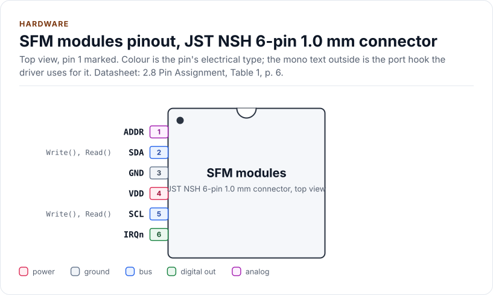
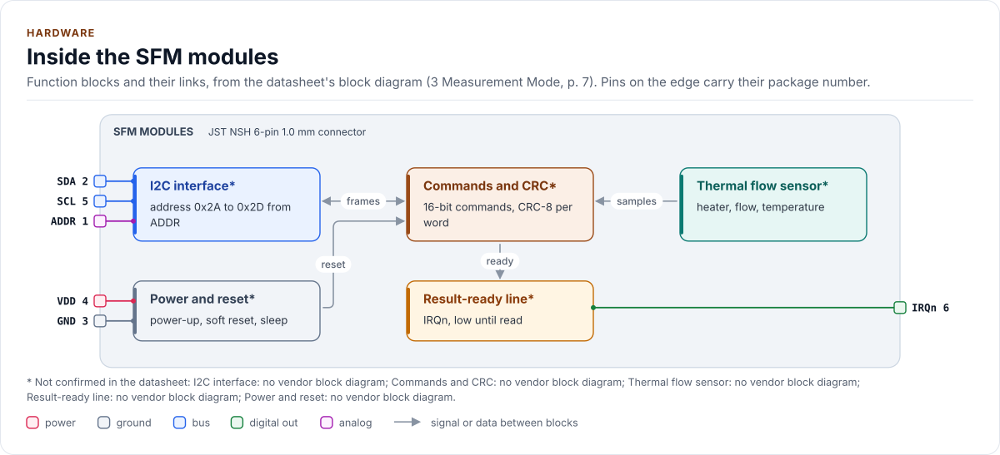
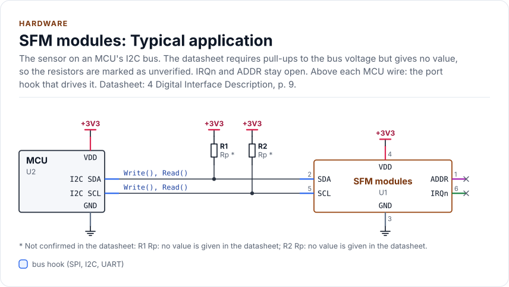
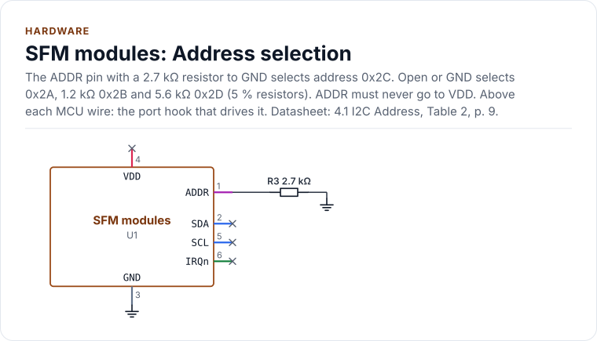

# Hardware

The connectors, addresses, bus settings, timing, power and fluidics of the supported modules, as the driver uses
them. These are flow meter modules with a connector, not chips in a package: the diagrams show the connector of the
SFM4300 as the reference and the other connectors are tabulated.

<!-- generated: datasheet-refs -->
??? abstract "Datasheet sections this page relies on"

    - Sf05 reset, restart and first read: Sensirion AG SFM3200 1.1, Digital interface (soft reset 80 ms, restart before read), [p. 5](https://sensirion.com/media/documents/70FC8320/62962251/GF_DS_SFM3200.pdf#page=5)
    - Sf04 trigger bytes and the hold-master read: Sensirion AG SFM4100 1.4, Digital interface (trigger, clock stretching, address per gas), [p. 4](https://sensirion.com/media/documents/6A24D8A6/65A002E6/GF_DS_SFM4100.pdf#page=4)
    - Timing (reset, first sample, wake-up, stop): Sensirion AG SFM4300 D1 1.0, 2.4 Timing specification, [p. 5](https://sensirion.com/media/documents/024CBAA1/62987ADF/Sensirion_Datasheet_SFM4300.pdf#page=5)
    - Electrical specification and limits: Sensirion AG SFM4300 D1 1.0, 2.3 Electrical specification; 2.7 Absolute maximum ratings, [p. 5](https://sensirion.com/media/documents/024CBAA1/62987ADF/Sensirion_Datasheet_SFM4300.pdf#page=5)
    - Connector and pins: Sensirion AG SFM4300 D1 1.0, 2.8 Electrical connection, Table 1, [p. 6](https://sensirion.com/media/documents/024CBAA1/62987ADF/Sensirion_Datasheet_SFM4300.pdf#page=6)
    - IRQn and start-up behaviour: Sensirion AG SFM4300 D1 1.0, 3.2 Sensor start-up and warm-up; 3.3 IRQn, [p. 8](https://sensirion.com/media/documents/024CBAA1/62987ADF/Sensirion_Datasheet_SFM4300.pdf#page=8)
    - I2C address and bus: Sensirion AG SFM4300 D1 1.0, 4 Digital interface description; 4.1 I2C address, [p. 9](https://sensirion.com/media/documents/024CBAA1/62987ADF/Sensirion_Datasheet_SFM4300.pdf#page=9)
    - Soft reset (general call): Sensirion AG SFM4300 D1 1.0, 4.3.7 Soft reset, [p. 13](https://sensirion.com/media/documents/024CBAA1/62987ADF/Sensirion_Datasheet_SFM4300.pdf#page=13)
    - Fluidics, fittings and outline: Sensirion AG SFM4300 D1 1.0, 5 Fluidic specifications; 6 Package outline, [p. 17](https://sensirion.com/media/documents/024CBAA1/62987ADF/Sensirion_Datasheet_SFM4300.pdf#page=17)

    All of them, with the driver API for each: [Datasheet map](datasheet.md).
<!-- /generated -->

!!! note "Facts that are not verified"
    Every item below that no document read states is marked **unverified** and listed in
    [Not verified](#not-verified). The preliminary SFM6000D is tagged `[P]` wherever it appears. Nothing here has been
    checked against a unit on a bench.

## The reference module (SFM4300)

<!-- figure: chip-pinout -->
<picture>
  <source media="(prefers-color-scheme: dark)" srcset="diagrams/chip-pinout.dark.svg">
  
</picture>
<!-- /figure -->

<!-- generated: chip-pins -->
JST NSH 6-pin 1.0 mm connector, 6 pins (2.8 Pin Assignment, Table 1, [p. 6](https://sensirion.com/media/documents/024CBAA1/62987ADF/Sensirion_Datasheet_SFM4300.pdf#page=6)).

| Pin | Name | Type (domain) | Function | Driver hook | If unused | Datasheet |
| --- | --- | --- | --- | --- | --- | --- |
| 1 | `ADDR` | analog (VDD) | I2C address select: open or GND, or a resistor to GND (1.2, 2.7 or 5.6 kΩ); never VDD | - | Leave open (address 0x2A) | 4.1, [p. 9](https://sensirion.com/media/documents/024CBAA1/62987ADF/Sensirion_Datasheet_SFM4300.pdf#page=9) |
| 2 | `SDA` | bus (VDD) | I2C data, needs an external pull-up to the bus voltage | `Write(), Read()` | - | 4, [p. 9](https://sensirion.com/media/documents/024CBAA1/62987ADF/Sensirion_Datasheet_SFM4300.pdf#page=9) |
| 3 | `GND` | ground | Ground | - | - | 2.8, [p. 6](https://sensirion.com/media/documents/024CBAA1/62987ADF/Sensirion_Datasheet_SFM4300.pdf#page=6) |
| 4 | `VDD` | power (VDD) | Supply, 3.0 V to 5.5 V (3.3 V recommended) | - | - | 2.3, [p. 5](https://sensirion.com/media/documents/024CBAA1/62987ADF/Sensirion_Datasheet_SFM4300.pdf#page=5) |
| 5 | `SCL` | bus (VDD) | I2C clock, up to 1 MHz, needs an external pull-up | `Write(), Read()` | - | 4, [p. 9](https://sensirion.com/media/documents/024CBAA1/62987ADF/Sensirion_Datasheet_SFM4300.pdf#page=9) |
| 6 | `IRQn` | digital out (VDD) | Active low: a result is ready, or the sensor reset | - | Leave open; never to GND or VDD | 3.3, [p. 8](https://sensirion.com/media/documents/024CBAA1/62987ADF/Sensirion_Datasheet_SFM4300.pdf#page=8) |

Source of this table and of the chip figures: [`docs/hardware.yml`](hardware.yml).
<!-- /generated -->

<!-- figure: chip-blocks -->
<picture>
  <source media="(prefers-color-scheme: dark)" srcset="diagrams/chip-blocks.dark.svg">
  
</picture>
<!-- /figure -->

<!-- figure: chip-circuit-typical -->
<picture>
  <source media="(prefers-color-scheme: dark)" srcset="diagrams/chip-circuit-typical.dark.svg">
  
</picture>
<!-- /figure -->

<!-- figure: chip-circuit-address -->
<picture>
  <source media="(prefers-color-scheme: dark)" srcset="diagrams/chip-circuit-address.dark.svg">
  
</picture>
<!-- /figure -->

## Connectors

One row per connector. Pins are in the order the datasheet gives; where it prints no numbers the pins are numbered
in drawing order and the row says so.

| Id | Connector | Pins | Parts |
| --- | --- | --- | --- |
| C-NSH6 | JST NSH 6-pin, 1.0 mm (BM06B-NSHSS-TBT) | 1 ADDR, 2 SDA, 3 GND, 4 VDD, 5 SCL, 6 IRQn | SFM4300 |
| C-DURA4 | Molex DuraClik 502351-0400, 4-pin, 2.0 mm | drawing order SDA, GND, VDD, SCL (no numbers printed) | SFM3003, SFM3013, SFM3019, SFM3119; SFM3000 (order **unverified**) |
| C-ZR4 | JST B4B-ZR-SM4-TF, 4-pin | 1 SDA, 2 GND, 3 VCC, 4 SCK | SFM3200 |
| C-PH5 | JST B5B-PH-SM4-TBT, 5-pin | 1 SCK, 2 VCC, 3 GND, 4 SDA, 5 /RES | SFM4200 |
| C-NSH5 | JST BM05B-NSHSS-TBT, 5-pin, 1.0 mm | 1 SDA, 2 VDD, 3 GND, 4 SCL, 5 DRDY | SFM3505 |
| C-PAD6 | 6-pad clip-on interface | SFM3304: HEATER_GND, VDD, SCL, GND, SDA, HEATER (heater 51 Ω, 0.5 W max); other parts **unverified** | SFM3304, SFM3200-AW, SFM3300, SFM3400 |
| C-HDR8 | 8-pin header (E-Tec SL2-008-SH108/01-55B or Samtec HTSW-104-07-6.D) | **unverified** (the figure was not extracted) | SFM4100 |
| C-MLP6 | Molex Micro-Lock Plus, 6 circuits, 1.25 mm | 1 VDD, 2 GND, 3 reserved, 4 SCL, 5 ADDR, 6 SDA `[P]` | SFM6000D |

SDA and SCL need external pull-ups to the bus voltage on every part. No document gives a value for the SF06 parts;
choose it for your bus capacitance and clock. The ADDR pin of the SFM4300 must never be connected to VDD, and IRQn
must stay open when it is not used (never to GND or VDD).

## Variants

The table is what the driver's part table holds (`parts::kTable`), and the tests compare it with expectations typed
from the datasheets by hand. Span is the specified measuring range in standard litres per minute (SFM4100: standard
cubic centimetres per minute, as the vendor states it).

| Variant | Family | Address | Supply (V) | Max SCL | Span (slm) | Connector |
| --- | --- | --- | --- | --- | --- | --- |
| SFM4300-20-B, -O, -P | SF06 | 0x2A to 0x2D by ADDR | 3.0 to 5.5 | 1 MHz | 0 to 20 | C-NSH6 |
| SFM4300-50-B, -O, -P | SF06 | 0x2A to 0x2D by ADDR | 3.0 to 5.5 | 1 MHz | 0 to 50 | C-NSH6 |
| SFM3003-300-CL | SF06 | 0x28 | 2.7 to 5.5 | 1 MHz | -30 to 300 | C-DURA4 |
| SFM3003-300-CE | SF06 | 0x2D | 2.7 to 5.5 | 1 MHz | -150 to 300 | C-DURA4 |
| SFM3003-300-CET | SF06 | 0x2A | 2.7 to 5.5 | 1 MHz | -150 to 300 | C-DURA4 |
| SFM3013-300-CL, -CLM | SF06 | 0x2F | 2.7 to 5.5 | 1 MHz | -30 to 300 | C-DURA4 |
| SFM3019-200-CL | SF06 | 0x2E | 2.7 to 5.5 | 1 MHz | -10 to 240 | C-DURA4 |
| SFM3119-240-CL | SF06 | 0x29 | 2.7 to 5.5 | 1 MHz | -10 to 240 | C-DURA4 |
| SFM3304-250-D | SF06 gen 2 | 0x2E | 3.15 to 3.45 | 1 MHz | -250 to 250 | C-PAD6 |
| SFM3505-300, -300-X | SF06 dual | 0x2E | 3.2 to 3.4 | 1 MHz | -150 to 300 | C-NSH5 |
| SFM3000-200-C | SF05 | 0x40 | 4.75 to 5.25 | 400 kHz | -200 to 200 | C-DURA4 |
| SFM3200 | SF05 | 0x40 | 4.75 to 5.25 | 400 kHz | -100 to 250 | C-ZR4 |
| SFM3200-AW | SF05 | 0x40 | 4.75 to 5.25 | 400 kHz | -100 to 250 | C-PAD6 |
| SFM3300-D, -AW | SF05 | 0x40 | 4.75 to 5.25 | 400 kHz | -250 to 250 | C-PAD6 |
| SFM3400-D, -AW | SF05 | 0x40 | 4.75 to 5.25 | 400 kHz | -33 to 33 | C-PAD6 |
| SFM4200 | SF05 | 0x40 | 4.75 to 5.25 | 100 kHz | 0 to 160 | C-PH5 |
| SFM4100-Air, -O2, -CO2, -N2O, -Ar | SF04 | 1, 2, 3, 4, 5 by gas | 3.5 to 9.0 | 120 kHz | 0 to 20 | C-HDR8 |
| SFM6000D-50, -20, -5 `[P]` | SFx6000 | 0x24 default; 0x20 to 0x24, 0x41, 0x42 by ADDR | 22.8 to 25.2 | 1 MHz | 0 to 50, 0 to 20, 0 to 5 | C-MLP6 |

Address collisions matter: 0x2E is the SFM3019, the SFM3304 and the SFM3505, and 0x40 is every SF05 part. Two
sensors on one bus need different addresses, and the driver identifies a part only inside the family you configure
(`Variant::Auto`), never across families.

## Bus settings

| Setting | Value |
| --- | --- |
| Clock | 400 kHz typical, 1 MHz maximum for SF06, SFM3304, SFM3505 and SFx6000; 400 kHz for SFM3000/3200/3300/3400; 100 kHz for SFM4200; 120 kHz for SFM4100. 100 kHz (`kSafeClockHz`) suits every part |
| Address | 7-bit, no register byte; the sensor accepts raw command words |
| Write | START, address + W, command bytes (and an argument word with its CRC-8), STOP |
| Read | START, address + R, words of two bytes each followed by a CRC-8, the master NACKs the last byte, STOP |
| Poll | A normal write of the next real command (the stop command, the SF05 serial pointer, the SF04 register read), repeated until it is acknowledged; the driver never sends a write with no data byte |
| Repeated START | Not used. The documents show a STOP between a command and its read and neither allow nor forbid a repeated START (ambiguity K-RS) |

The CRC is CRC-8, polynomial 0x31, no reflection, final XOR 0x00; the initial value is 0xFF for the SF06 families
and the SFx6000 and 0x00 for SF05 and SF04. A read is always a whole number of three-byte words. The SF05 parts lock
up when the master NACKs the first data byte; the port must never abort a read early.

SF04 (SFM4100) reads need the sensor to hold SCL low while it measures ("hold master"). The port needs the optional
`ReadStretch()` hook for it, and a controller that does not tolerate a stretching slave cannot run that part.

## Timing

These are the datasheet maxima the table holds. `TimingPolicy::Conservative` (the default) waits 20 ms after every
SF06 reset and wake; `TimingPolicy::Datasheet` uses the per-part value and needs a known variant.

| Family | Power-up | Soft reset | First sample after start | Warm-up (accurate) | Wake |
| --- | --- | --- | --- | --- | --- |
| SFM4300 | 20 ms | 20 ms | 12 ms | 30 ms | 20 ms |
| SFM3003, 3013, 3019, 3119 | 2 ms | 2 ms | 12 ms | 30 ms | 16 ms |
| SFM3304, SFM3505 | 2 ms | 2 ms | 4 ms | 50 ms | 2 ms (SFM3505: no sleep) |
| SFM3000 | 100 ms | 80 ms | 30 ms | 30 ms | - |
| SFM3200, 3300, 3400 | 100 ms | 80 ms | 100 ms | 100 ms | - |
| SFM4200 | 2 ms | /RES pulse (unverified width) | 100 ms | 100 ms | - |
| SFM4100 | 20 ms | 20 ms | read when ready (stretch) | 500 ms | - |
| SFM6000D `[P]` | 30 ms | 30 ms | 12 ms | 1 s | - |

After a stop the SF06 parts accept a command within 0.5 ms. The SFM4300 documents 16 ms typical and 20 ms maximum
from reset to ready and says the 16 ms holds if SCL is high; the SFM3xxx datasheets say 2 ms for reset but 16 ms
typical for a wake from sleep (ambiguity K-TIME). That is why the conservative policy is the default. Under the
`Datasheet` policy a poll gives up a quarter after the figure; `Conservative` is the supported choice for sleep.

## Power and reset

- **General-call reset.** The soft reset of the SF06 parts is the byte 0x06 sent to address 0x00. It resets every
  device on the bus that listens. The driver refuses it unless you set `Config::allow_general_call_reset`, and the
  port provides `WriteGeneralCall()`. A sleeping sensor cannot be soft reset: wake it first.
- **Hardware reset.** The SFM4200 has a /RES pin (port hook `SetResetPin()`). The other SF05 parts and the SFM3505
  reset by cycling their supply (port hook `PowerCycle()`). The other parts have no hard reset in the driver: use the
  soft reset. Without the hook, `HardReset()` returns `Unsupported`. **Wiring:** SDA and SCL must be pulled low at the
  same time as /RES or while the supply is off (SFM4200 2.3, SFM3505 3.3.5), or the sensor stays powered through the
  bus lines and does not reset; the port hooks do this and the board must not back-feed the sensor through its
  pull-ups. See [Hard reset wiring](porting.md#hard-reset-wiring).
- **Sleep.** The SF06 parts (not the SFM3505) have a sleep mode of about 0.4 µA typical (SFM4300). A wake is a
  write to the address that the sensor does not acknowledge; the driver repeats the stop command until it is
  acknowledged.
- **Idle current.** 0.055 mA typical, 4.2 mA while measuring (SFM4300, VDD 3.3 V).
- **IRQn.** The SFM4300 pulls IRQn low when a result is ready and after a reset until the next start. The driver does
  not own the pin; use it as an interrupt to call `ReadSample()`.

## Fluidics and fittings

| Variant group | Connection | Outline (nominal, mm) |
| --- | --- | --- |
| SFM4300-xx-B | Base-mount flanges, 7 mm openings | 92.5 x 32 x 29.3 |
| SFM4300-xx-O | O-ring, 8 mm openings | 64.5 x 26 x 26.2 |
| SFM4300-xx-P | 8 mm push-in, tube outer diameter 8 mm | 77 x 26 x 26.2 |
| SFM3003, SFM3013, SFM3019 | 22 mm conical ends, ISO 5356 | 82 x 31.5 x 34.4 |
| SFM3119 | 19 mm tube, 16.6 mm ends, NBR O-ring 16.1 x 1.6 | 57.5 x 27.5 x 29.4 |
| SFM3304, SFM3300 | ISO 5356-1 cones 22 mm and 15 mm | body 69.3 |
| SFM3200 | 22 mm cones | body 73.0 |
| SFM3400 | 15 mm cone (ISO 5356-1) | body 60 |
| SFM3505 | Inlet inner diameter 14.0 mm, O-ring 16.1 x 1.6 | - |
| SFM4100 | Legris 6 mm downmount fittings; overpressure 10 bar, burst above 20 bar | - |
| SFM6000D `[P]` | Push-in 6 mm | **unverified** |

The dimensions are read off the datasheets' drawings, which print tolerances (for example 92.5 ± 0.75), so treat
them as nominal. The SFM4300 is calibrated with the connector up and the flow horizontal. Operating temperature is
+5 to +50 °C for the SFM4300 and the SFM3300, +10 to +50 °C for the SFM3200, -20 to +80 °C for the SFM3000 (0.7 to
1.3 bar).

## Not verified

| What | Why | Marked as |
| --- | --- | --- |
| Pin order of the SFM3000 four-pin connector | The datasheet shows a connector type, not the order | `unverified` |
| Pad names of the 6-pad interface except on the SFM3304 | The SFM3200-AW, SFM3300 and SFM3400 datasheets show pads without names | `unverified` |
| The 8-pin header functions of the SFM4100 | The figure was not extracted | `unverified` |
| The SFM4200 /RES pulse width | It is in a drawing that was not read | `unverified` (the driver uses a default) |
| Pull-up values of every SF06 part | No document gives one | `unverified` in the circuit |
| Every SFM6000D fact | The vendor marks the interface reference "preliminary" | `[P]` |
| SFM6000D outline and fitting dimensions | The figures were not read | `unverified` |
| Outline tolerances | Read by eye from drawings | nominal values |

## Reference documents

32 vendor documents were read; none is committed. The card lists the revisions the driver was written against, with
the SHA-256 of each file, so you can confirm that you hold the same one.

<!-- generated: datasheet-card -->
| Document | Revision | Get it |
| --- | --- | --- |
| Datasheet: SFM3000 digital mass flow meter (Sensirion AG SFM3000) | 2.2, July 2016 | [vendor page](https://sensirion.com/media/documents/BA2F2B48/616681DC/Sensirion_Mass_Flow_Meters_SFM3000_Datasheet.pdf) |
| Datasheet: SFM3003 digital mass flow meter (Sensirion AG SFM3003 D1) | 1.1, June 2024 | [vendor page](https://sensirion.com/media/documents/E351AEF6/66BDAB43/GF_DS_SFM3003.pdf) |
| Datasheet: SFM3003-300-CET digital mass flow meter (Sensirion AG SFM3003-300-CET) | 1.0, April 2022 | [vendor page](https://sensirion.com/media/documents/879F57CF/62975EDE/Senirion_Datasheet_SFM3003-300-CET.pdf) |
| Datasheet: SFM3013 digital mass flow meter (Sensirion AG SFM3013 D3) | 1.1, June 2024 | [vendor page](https://sensirion.com/media/documents/1018F46C/66BDAB5A/GF_DS_SFM3013.pdf) |
| Datasheet: SFM3019 digital mass flow meter (Sensirion AG SFM3019 D1) | 1.3, not printed (vendor page: 08/2024) | [vendor page](https://sensirion.com/media/documents/527C8187/6AE9A71D/Sensirion_Datasheet_SFM3019_EN.pdf) |
| Datasheet: SFM3020 analog mass flow meter (reviewed, not supported) (Sensirion AG SFM3020) | 1.2, not printed | [vendor page](https://sensirion.com/media/documents/3CBC9FC5/6AE9A6F1/Sensirion_Datasheet_SFM3020_EN.pdf) |
| Datasheet: SFM3100 analog mass flow meter (reviewed, not supported) (Sensirion AG SFM3100) | 1.5, not printed (vendor page: 08/2026) | [vendor page](https://sensirion.com/media/documents/27637785/6A71EB6F/GF_DS_SFM3100.pdf) |
| Datasheet: SFM3119 digital mass flow meter (Sensirion AG SFM3119 D1) | 1.3, September 2023 | [vendor page](https://sensirion.com/media/documents/559B741F/651C2866/GF_DS_SFM3119_v1_3.pdf) |
| Datasheet: SFM3200 digital mass flow meter (Sensirion AG SFM3200) | 1.1, May 2017 | [PDF](https://sensirion.com/media/documents/70FC8320/62962251/GF_DS_SFM3200.pdf) · [vendor page](https://sensirion.com/media/documents/70FC8320/62962251/GF_DS_SFM3200.pdf) |
| Datasheet: SFM3200-AW digital mass flow meter (Sensirion AG SFM3200-AW) | 1.1, March 2022 | [vendor page](https://sensirion.com/media/documents/CF8EB396/62D12B6B/Sensirion_Datasheet_SFM3200-AW.pdf) |
| Datasheet: SFM3300-D and SFM3300-AW digital mass flow meters (Sensirion AG SFM3300) | 1.4, March 2022 | [vendor page](https://sensirion.com/media/documents/8ECF0D28/62D13110/Sensirion_Datasheet_SFM3300-AW_SFM3300-D.pdf) |
| Datasheet: SFM3304-xxx-D digital mass flow meter (Sensirion AG SFM3304) | 1.3, not printed (vendor page: 09/2026) | [PDF](https://sensirion.com/media/documents/8C3FC034/6AA3DD2E/GF_DS_SFM3304-xxx-D.pdf) · [vendor page](https://sensirion.com/media/documents/8C3FC034/6AA3DD2E/GF_DS_SFM3304-xxx-D.pdf) |
| Application note: Transition guide SFM3300-250-D to SFM3304-250-D (Sensirion AG SFM3300-SFM3304 transition) | 1, not printed (vendor page: 10/2026) | [vendor page](https://sensirion.com/media/documents/194FE050/6AE46AF4/Sensirion_application_note_transition_guide_GF_AN_SFM3300_SFM3304_EN.pdf) |
| Datasheet: SFM3400-AW and SFM3400-D digital mass flow meters (Sensirion AG SFM3400) | 1.5, January 2024 | [vendor page](https://sensirion.com/media/documents/9EE7E5FF/659D365C/GF_DS_SFM3400AW_SFM3400D.pdf) |
| Datasheet: SFM3505 digital mass flow meter (Sensirion AG SFM3505 D3) | 1.0, October 2025 | [PDF](https://sensirion.com/media/documents/03EE880B/68F8CF90/GF_DS_SFM3505.pdf) · [vendor page](https://sensirion.com/media/documents/03EE880B/68F8CF90/GF_DS_SFM3505.pdf) |
| Datasheet: SFM4100 series digital mass flow meters (Sensirion AG SFM4100) | 1.4, January 2024 | [PDF](https://sensirion.com/media/documents/6A24D8A6/65A002E6/GF_DS_SFM4100.pdf) · [vendor page](https://sensirion.com/media/documents/6A24D8A6/65A002E6/GF_DS_SFM4100.pdf) |
| Application note: CRC calculation for the SFM4100 (Sensirion AG SFM4100 CRC) | 1.0, June 2009 | [PDF](https://sensirion.com/media/documents/FA1A9B3B/6165B558/Sensirion_Mass_Flow_Meters_CRC_Calculation_V1_1.pdf) · [vendor page](https://sensirion.com/media/documents/FA1A9B3B/6165B558/Sensirion_Mass_Flow_Meters_CRC_Calculation_V1_1.pdf) |
| Application note: SFM4100 sample code (Sensirion AG SFM4100 sample code) | 1.0, July 2009 | [vendor page](https://sensirion.com/media/documents/4E4E4F83/617C06E2/Sensirion_Mass_Flow_Meters_Software_SFM4100_Sample_Code.pdf) |
| Datasheet: SFM4200 digital mass flow meter (Sensirion AG SFM4200 D1) | 1.2, August 2018 | [vendor page](https://sensirion.com/media/documents/7AA39BF4/65436B98/GF_DS_SFM4200-v1.2-D1.pdf) |
| Datasheet: SFM4300 series digital mass flow meters (Sensirion AG SFM4300 D1) | 1.0, April 2022 | [PDF](https://sensirion.com/media/documents/024CBAA1/62987ADF/Sensirion_Datasheet_SFM4300.pdf) · [vendor page](https://sensirion.com/media/documents/024CBAA1/62987ADF/Sensirion_Datasheet_SFM4300.pdf) |
| Datasheet: SFC5300 and SFM5300 (2016; reviewed, not supported) (Sensirion AG SFM5300 (2016)) | not printed, 2016 | [vendor page](https://sensirion.com/media/documents/58AAFA86/61668D0A/Sensirion_Mass_Flow_Meters_SFM5300_Datasheet.pdf) |
| Datasheet: SFC5300/SFM5300 and SFC5330/SFM5330 (reviewed, not supported) (Sensirion AG SFx53x0) | 05/2023, May 2023 | [vendor page](https://sensirion.com/media/documents/3B14FBDD/645220AD/GF_DS_SFC53x0_SFM53x0.pdf) |
| Datasheet: SFC5400 and SFM5400 (reviewed, not supported) (Sensirion AG SFx5400) | 05/2023, May 2023 | [vendor page](https://sensirion.com/media/documents/AF658E7B/645221C1/GF_DS_SFC5400_SFM5400.pdf) |
| Datasheet: SFC5460 and SFM5460 (reviewed, not supported) (Sensirion AG SFx5460) | 05/2023, May 2023 | [vendor page](https://sensirion.com/media/documents/68F6FE26/64522277/GF_DS_SFC5460_SFM5460.pdf) |
| Datasheet: SFC5500 and SFM5500 (reviewed, not supported) (Sensirion AG SFx5500) | 02/2024, February 2024 | [vendor page](https://sensirion.com/media/documents/92E99F10/65CDCACE/GF_DS_SFC5500_SFM5500_003.pdf) |
| Reference manual: SFC5xxx SHDLC interface reference (reviewed, not supported) (Sensirion AG SFC5xxx SHDLC) | 1.9, October 2015 | [vendor page](https://sensirion.com/media/documents/B3F417D2/61F8E792/GF_AN_SFC5xxx_ShdlcInterfaceReference_V1_9_D1.pdf) |
| Datasheet: SFC6000D and SFM6000D digital mass flow meters (Sensirion AG SFx6000D D1) | 1.1, May 2023 | [vendor page](https://sensirion.com/media/documents/442A3611/64958B2C/DS_SFC6000D_SFM6000D.pdf) |
| Reference manual: SFC6xxx/SFM6xxx I2C interface reference (preliminary) (Sensirion AG SFx6000 I2C) | 1.1, not printed (vendor page: 07/2023) | [PDF](https://sensirion.com/media/documents/3D857436/65156AC0/GF_AN_SFC6xxx_I2C_InterfaceReference1.1.pdf) · [vendor page](https://sensirion.com/media/documents/3D857436/65156AC0/GF_AN_SFC6xxx_I2C_InterfaceReference1.1.pdf) |
| Reference manual: SFC6xxx/SFM6xxx RS485 SHDLC guide (reviewed, not supported) (Sensirion AG SFx6000 SHDLC) | 1.1, not printed | [vendor page](https://sensirion.com/media/documents/88CA2961/65156AEC/GF_AN_SFX6000_SHDLCGuide1.1.pdf) |
| Application note: SFM-05 I2C functional description for the SFM3x00 series (Sensirion AG SFM-05) | not printed (vendor page: 10/2026), not printed | [PDF](https://sensirion.com/media/documents/BE7405C4/6AC34DFB/GF_AN_SFM-05_I2C_Functional_Description.pdf) · [vendor page](https://sensirion.com/media/documents/BE7405C4/6AC34DFB/GF_AN_SFM-05_I2C_Functional_Description.pdf) |
| Application note: SFM-04 CRC checksum (Sensirion AG SFM-04 D1) | not printed, not printed (vendor page: 01/2020) | [vendor page](https://sensirion.com/media/documents/1E3CD1FF/6165AFE4/Sensirion_GF_AN_SFM-04_CRC_Checksum_D1.pdf) |
| Application note: SFM-01 engineering guidelines for mass flow meters (Sensirion AG SFM-01) | not printed, not printed | [vendor page](https://sensirion.com/media/documents/1DDDD810/61669D98/Sensirion_GF_AN_SFM-01_Engineering_Guidelines_For_Mass_Flow_Meters_D.pdf) |

Written against these revisions; the SHA-256 of each file is in [`docs/datasheets.yml`](datasheets.yml). Where each part
of the driver is in the datasheet: [Datasheet map](datasheet.md).
<!-- /generated -->

| Also useful | Contents |
| --- | --- |
| [`inc/sfm_flow_meter_registers.hpp`](../inc/sfm_flow_meter_registers.hpp) | The command and pointer codes as the driver uses them |
| [`inc/sfm_flow_meter_parts.hpp`](../inc/sfm_flow_meter_parts.hpp) | The table of 32 parts: addresses, scales, timing, features |
