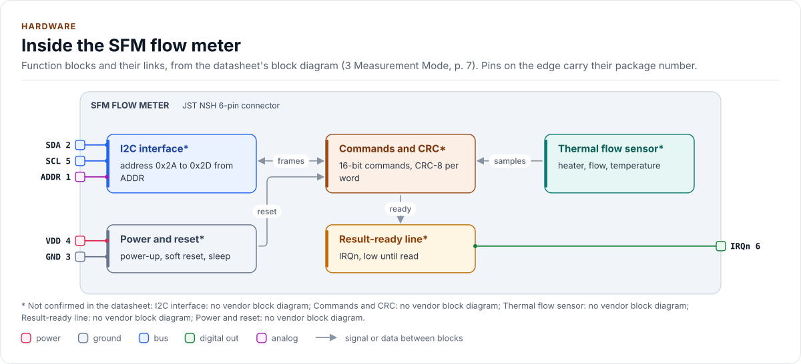
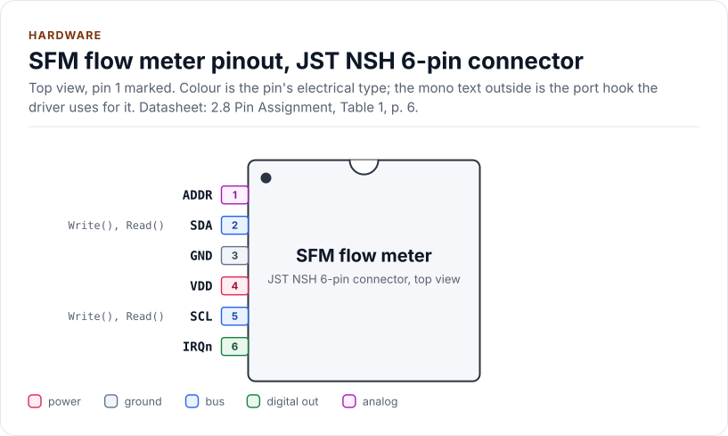
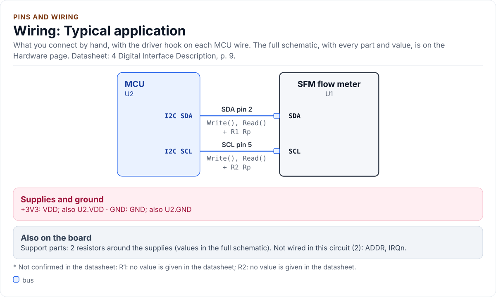

---
hide:
  - navigation
  - toc
---

<div class="kb-hero" markdown>
<span class="kb-kicker">Digital gas mass flow meter</span>

# SFM Flow Meter Driver

<p>A C++20 driver for the Sensirion SFM digital mass flow meters on I2C: the SFM4300, SFM3003, SFM3013, SFM3019,
SFM3119, SFM3304, SFM3505, the legacy SFM3000, SFM3200, SFM3300, SFM3400, SFM4200 and SFM4100, and the preliminary
SFM6000D. One API, 32 variants, on any MCU.</p>

[Quickstart](quickstart.md){ .md-button .md-button--primary }
[API guide](api-guide.md){ .md-button }
[Source on GitHub](https://github.com/kokeb-labs-drivers/driver-sfm-flow-meter){ .md-button }
</div>

<!-- generated: chip-summary -->
The **SFM flow meter** is a family of digital gas mass flow sensors on I2C: each part reports the flow of its calibrated
gases and gas mixtures and its own temperature as 16-bit words, and the reference SFM4300 does so for air, oxygen,
nitrous oxide and carbon dioxide (Product Summary, [p.
1](https://sensirion.com/media/documents/024CBAA1/62987ADF/Sensirion_Datasheet_SFM4300.pdf#page=1)).
<!-- /generated -->

!!! warning "Not a safety device"
    The vendor states that these sensors are not designed for safety-critical or life-supporting use unless the
    datasheet says so. This driver is verified against a model of the chip, not against hardware, and carries no
    medical or safety claim. See [Contract](contract.md#what-is-not-verified).

<!-- figure: chip-hero -->
<picture>
  <source media="(prefers-color-scheme: dark)" srcset="diagrams/chip-hero.dark.svg">
  
</picture>
<!-- /figure -->

## What it does

<!-- figure: chip-capabilities -->
<picture>
  <source media="(prefers-color-scheme: dark)" srcset="diagrams/chip-capabilities.dark.svg">
  
</picture>
<!-- /figure -->

## Where it is used

<!-- generated: chip-uses -->
- Medical gas mixing, for example anesthesia and vaporizers
- Industrial gas mixing, for example welding and gas purging

Uses named by the datasheet (Product Summary, [p.
1](https://sensirion.com/media/documents/024CBAA1/62987ADF/Sensirion_Datasheet_SFM4300.pdf#page=1)).
<!-- /generated -->

## Inside the module

<!-- figure: chip-blocks -->
<picture>
  <source media="(prefers-color-scheme: dark)" srcset="diagrams/chip-blocks.dark.svg">
  
</picture>
<!-- /figure -->

## Pins and wiring

<!-- figure: chip-pinout -->
<picture>
  <source media="(prefers-color-scheme: dark)" srcset="diagrams/chip-pinout.dark.svg">
  
</picture>
<!-- /figure -->

<!-- figure: chip-wiring-typical -->
<picture>
  <source media="(prefers-color-scheme: dark)" srcset="diagrams/chip-wiring-typical.dark.svg">
  
</picture>
<!-- /figure -->

Every connector, the addresses, supply ranges, timings and fittings of every variant: [Hardware](hardware.md).

## Quick start

Wire the sensor as above, write the port ([Porting](porting.md)), then read a flow:

```cpp
--8<-- "tests/docs/quickstart.cpp:quickstart"
```

The steps explained: [Quickstart](quickstart.md).

## Driver coverage

<!-- generated: chip-coverage -->
| Capability | What the chip does | Driver API | Registers | Status | Datasheet |
| --- | --- | --- | --- | --- | --- |
| [Flow measurement](api-guide.md) | Starts continuous measurement and reads each CRC-checked sample as a flow in millilitres per minute | `StartMeasurement`, `ReadSample`, `Poll`, `AwaitPending`, `ReadRawReply` | `kCmdStartGas0`, `kCmdStartGas1` | Supported | 4.3.1, [p. 10](https://sensirion.com/media/documents/024CBAA1/62987ADF/Sensirion_Datasheet_SFM4300.pdf#page=10) |
| [Gas and gas mixture](api-guide.md) | Picks the calibrated gas or an oxygen mixture, and changes the mixture without stopping the sensor | `StartMeasurement`, `UpdateConcentration` | `kCmdStartMixture0`, `kCmdUpdateConcentration`, `kCmdResultPointer` | Supported | 4.3.3, [p. 11](https://sensirion.com/media/documents/024CBAA1/62987ADF/Sensirion_Datasheet_SFM4300.pdf#page=11) |
| [Temperature](api-guide.md) | Reads the sensor temperature from the sample where the part sends it, or by a pointer sequence | `ReadSample`, `ReadTemperature` | `kCmdSfxTemperature`, `kSf05Temperature` | Supported | 2.2, [p. 5](https://sensirion.com/media/documents/024CBAA1/62987ADF/Sensirion_Datasheet_SFM4300.pdf#page=5) |
| [Averaging](api-guide.md) | Averages until the read, or over a fixed number of the 2 kHz measurements | `SetAveraging` | `kCmdAveraging` | Supported | 4.3.5, [p. 12](https://sensirion.com/media/documents/024CBAA1/62987ADF/Sensirion_Datasheet_SFM4300.pdf#page=12) |
| [Scale factor and offset](api-guide.md) | Reads the sensor's scale factor, offset and unit and checks them against the datasheet table | `ReadScaling` | `kCmdReadScale` | Supported | 4.3.6, [p. 13](https://sensirion.com/media/documents/024CBAA1/62987ADF/Sensirion_Datasheet_SFM4300.pdf#page=13) |
| [Product identification](api-guide.md) | Reads the product identifier or serial number and matches it to one of the 32 variants | `BeginInitialize`, `EnsureInitialized`, `GetProductInfo` | `kCmdProductId` | Supported | 4.3.9, [p. 14](https://sensirion.com/media/documents/024CBAA1/62987ADF/Sensirion_Datasheet_SFM4300.pdf#page=14) |
| [Sleep and reset](api-guide.md) | Stops the measurement, sleeps and wakes the sensor, and resets it by command, reset pin or supply cycle | `Stop`, `Sleep`, `WakeUp`, `SoftReset`, `HardReset` | `kCmdStop`, `kCmdSleep`, `kGeneralCallReset` | Supported | 4.3.8, [p. 14](https://sensirion.com/media/documents/024CBAA1/62987ADF/Sensirion_Datasheet_SFM4300.pdf#page=14) |
| [Status and fault checks](api-guide.md) | Checks each sample's status word and range, and reports a reset, a stale value or a CRC error | `ReadSample`, `ReadRawReply` | - | Supported | 4.3.2, [p. 11](https://sensirion.com/media/documents/024CBAA1/62987ADF/Sensirion_Datasheet_SFM4300.pdf#page=11) |
| [Result-ready line](hardware.md) | IRQn goes low when a reading is ready; the driver polls over I2C and leaves the pin open | - | - | Not covered | 3.3, [p. 8](https://sensirion.com/media/documents/024CBAA1/62987ADF/Sensirion_Datasheet_SFM4300.pdf#page=8) |

**Supported**: the driver covers it and a host test checks it; **Not covered**: the chip has it and the driver leaves it
alone.

From [`docs/hardware.yml`](hardware.yml); `kokeb-docs hardware --check` confirms that every API name is in
`inc/sfm_flow_meter.hpp`, `inc/sfm_flow_meter_types.hpp` and every register in `inc/sfm_flow_meter_registers.hpp`.
<!-- /generated -->

The driver has no platform code. You give it a small class that brings the bus up and moves bytes; it does the
rest: identification, scaling checks, the command sequences of each protocol family, the CRC of every word, the
status checks, the waits and the recovery rules.

- **One object for every part.** `SfmFlowMeter<YourPort>` takes a reference to your port and does no I/O until
  you initialise it. The part is data (a table of 32 rows); the code branches on the protocol family only. See
  [Architecture](architecture.md).
- **Errors you can act on.** Every call returns `Result<T>` with an `Error` such as `NoData`, `Crc`,
  `DeviceReset` or `StateUnknown`. See [API guide](api-guide.md#handle-errors).
- **Non-blocking by construction.** Calls that need a wait return it; you sleep, then `Poll()`. A blocking
  wrapper exists when the port has `DelayUs()`. See [API guide](api-guide.md#run-without-blocking).
- **Datasheet defaults.** `PresetFor(variant)` gives a valid `Config` for each part; `CheckedConfig` proves one
  valid at build time. See [Configuration](configuration.md).
- **Zero-overhead portability.** The port is a CRTP class checked by a concept: the bus hooks, plus optional
  delay, clock, log, clock-stretching read, general call, power cycle and reset pin found at compile time. See
  [Porting](porting.md).
- **No heap, no exceptions, no RTTI.** The host tests build with `-fno-exceptions -fno-rtti`. See
  [Contract](contract.md).
- **Tested without hardware.** Host tests run every part against an independent model of the sensor, a fuzzer
  checks the driver's promises, and the coverage gate includes MC/DC. See [Testing and CI](testing.md).

## Datasheet

<!-- generated: datasheet-card -->
| Document | Revision | Get it |
| --- | --- | --- |
| Datasheet: SFM3000 digital mass flow meter (Sensirion AG SFM3000) | 2.2, July 2016 | [vendor page](https://sensirion.com/media/documents/BA2F2B48/616681DC/Sensirion_Mass_Flow_Meters_SFM3000_Datasheet.pdf) |
| Datasheet: SFM3003 digital mass flow meter (Sensirion AG SFM3003 D1) | 1.1, June 2024 | [vendor page](https://sensirion.com/media/documents/E351AEF6/66BDAB43/GF_DS_SFM3003.pdf) |
| Datasheet: SFM3003-300-CET digital mass flow meter (Sensirion AG SFM3003-300-CET) | 1.0, April 2022 | [vendor page](https://sensirion.com/media/documents/879F57CF/62975EDE/Senirion_Datasheet_SFM3003-300-CET.pdf) |
| Datasheet: SFM3013 digital mass flow meter (Sensirion AG SFM3013 D3) | 1.1, June 2024 | [vendor page](https://sensirion.com/media/documents/1018F46C/66BDAB5A/GF_DS_SFM3013.pdf) |
| Datasheet: SFM3019 digital mass flow meter (Sensirion AG SFM3019 D1) | 1.3, not printed (vendor page: 08/2024) | [vendor page](https://sensirion.com/media/documents/527C8187/6AE9A71D/Sensirion_Datasheet_SFM3019_EN.pdf) |
| Datasheet: SFM3020 analog mass flow meter (reviewed, not supported) (Sensirion AG SFM3020) | 1.2, not printed | [vendor page](https://sensirion.com/media/documents/3CBC9FC5/6AE9A6F1/Sensirion_Datasheet_SFM3020_EN.pdf) |
| Datasheet: SFM3100 analog mass flow meter (reviewed, not supported) (Sensirion AG SFM3100) | 1.5, not printed (vendor page: 08/2026) | [vendor page](https://sensirion.com/media/documents/27637785/6A71EB6F/GF_DS_SFM3100.pdf) |
| Datasheet: SFM3119 digital mass flow meter (Sensirion AG SFM3119 D1) | 1.3, September 2023 | [vendor page](https://sensirion.com/media/documents/559B741F/651C2866/GF_DS_SFM3119_v1_3.pdf) |
| Datasheet: SFM3200 digital mass flow meter (Sensirion AG SFM3200) | 1.1, May 2017 | [PDF](https://sensirion.com/media/documents/70FC8320/62962251/GF_DS_SFM3200.pdf) · [vendor page](https://sensirion.com/media/documents/70FC8320/62962251/GF_DS_SFM3200.pdf) |
| Datasheet: SFM3200-AW digital mass flow meter (Sensirion AG SFM3200-AW) | 1.1, March 2022 | [vendor page](https://sensirion.com/media/documents/CF8EB396/62D12B6B/Sensirion_Datasheet_SFM3200-AW.pdf) |
| Datasheet: SFM3300-D and SFM3300-AW digital mass flow meters (Sensirion AG SFM3300) | 1.4, March 2022 | [vendor page](https://sensirion.com/media/documents/8ECF0D28/62D13110/Sensirion_Datasheet_SFM3300-AW_SFM3300-D.pdf) |
| Datasheet: SFM3304-xxx-D digital mass flow meter (Sensirion AG SFM3304) | 1.3, not printed (vendor page: 09/2026) | [PDF](https://sensirion.com/media/documents/8C3FC034/6AA3DD2E/GF_DS_SFM3304-xxx-D.pdf) · [vendor page](https://sensirion.com/media/documents/8C3FC034/6AA3DD2E/GF_DS_SFM3304-xxx-D.pdf) |
| Application note: Transition guide SFM3300-250-D to SFM3304-250-D (Sensirion AG SFM3300-SFM3304 transition) | 1, not printed (vendor page: 10/2026) | [vendor page](https://sensirion.com/media/documents/194FE050/6AE46AF4/Sensirion_application_note_transition_guide_GF_AN_SFM3300_SFM3304_EN.pdf) |
| Datasheet: SFM3400-AW and SFM3400-D digital mass flow meters (Sensirion AG SFM3400) | 1.5, January 2024 | [vendor page](https://sensirion.com/media/documents/9EE7E5FF/659D365C/GF_DS_SFM3400AW_SFM3400D.pdf) |
| Datasheet: SFM3505 digital mass flow meter (Sensirion AG SFM3505 D3) | 1.0, October 2025 | [PDF](https://sensirion.com/media/documents/03EE880B/68F8CF90/GF_DS_SFM3505.pdf) · [vendor page](https://sensirion.com/media/documents/03EE880B/68F8CF90/GF_DS_SFM3505.pdf) |
| Datasheet: SFM4100 series digital mass flow meters (Sensirion AG SFM4100) | 1.4, January 2024 | [PDF](https://sensirion.com/media/documents/6A24D8A6/65A002E6/GF_DS_SFM4100.pdf) · [vendor page](https://sensirion.com/media/documents/6A24D8A6/65A002E6/GF_DS_SFM4100.pdf) |
| Application note: CRC calculation for the SFM4100 (Sensirion AG SFM4100 CRC) | 1.0, June 2009 | [PDF](https://sensirion.com/media/documents/FA1A9B3B/6165B558/Sensirion_Mass_Flow_Meters_CRC_Calculation_V1_1.pdf) · [vendor page](https://sensirion.com/media/documents/FA1A9B3B/6165B558/Sensirion_Mass_Flow_Meters_CRC_Calculation_V1_1.pdf) |
| Application note: SFM4100 sample code (Sensirion AG SFM4100 sample code) | 1.0, July 2009 | [vendor page](https://sensirion.com/media/documents/4E4E4F83/617C06E2/Sensirion_Mass_Flow_Meters_Software_SFM4100_Sample_Code.pdf) |
| Datasheet: SFM4200 digital mass flow meter (Sensirion AG SFM4200 D1) | 1.2, August 2018 | [vendor page](https://sensirion.com/media/documents/7AA39BF4/65436B98/GF_DS_SFM4200-v1.2-D1.pdf) |
| Datasheet: SFM4300 series digital mass flow meters (Sensirion AG SFM4300 D1) | 1.0, April 2022 | [PDF](https://sensirion.com/media/documents/024CBAA1/62987ADF/Sensirion_Datasheet_SFM4300.pdf) · [vendor page](https://sensirion.com/media/documents/024CBAA1/62987ADF/Sensirion_Datasheet_SFM4300.pdf) |
| Datasheet: SFC5300 and SFM5300 (2016; reviewed, not supported) (Sensirion AG SFM5300 (2016)) | not printed, 2016 | [vendor page](https://sensirion.com/media/documents/58AAFA86/61668D0A/Sensirion_Mass_Flow_Meters_SFM5300_Datasheet.pdf) |
| Datasheet: SFC5300/SFM5300 and SFC5330/SFM5330 (reviewed, not supported) (Sensirion AG SFx53x0) | 05/2023, May 2023 | [vendor page](https://sensirion.com/media/documents/3B14FBDD/645220AD/GF_DS_SFC53x0_SFM53x0.pdf) |
| Datasheet: SFC5400 and SFM5400 (reviewed, not supported) (Sensirion AG SFx5400) | 05/2023, May 2023 | [vendor page](https://sensirion.com/media/documents/AF658E7B/645221C1/GF_DS_SFC5400_SFM5400.pdf) |
| Datasheet: SFC5460 and SFM5460 (reviewed, not supported) (Sensirion AG SFx5460) | 05/2023, May 2023 | [vendor page](https://sensirion.com/media/documents/68F6FE26/64522277/GF_DS_SFC5460_SFM5460.pdf) |
| Datasheet: SFC5500 and SFM5500 (reviewed, not supported) (Sensirion AG SFx5500) | 02/2024, February 2024 | [vendor page](https://sensirion.com/media/documents/92E99F10/65CDCACE/GF_DS_SFC5500_SFM5500_003.pdf) |
| Reference manual: SFC5xxx SHDLC interface reference (reviewed, not supported) (Sensirion AG SFC5xxx SHDLC) | 1.9, October 2015 | [vendor page](https://sensirion.com/media/documents/B3F417D2/61F8E792/GF_AN_SFC5xxx_ShdlcInterfaceReference_V1_9_D1.pdf) |
| Datasheet: SFC6000D and SFM6000D digital mass flow meters (Sensirion AG SFx6000D D1) | 1.1, May 2023 | [vendor page](https://sensirion.com/media/documents/442A3611/64958B2C/DS_SFC6000D_SFM6000D.pdf) |
| Reference manual: SFC6xxx/SFM6xxx I2C interface reference (preliminary) (Sensirion AG SFx6000 I2C) | 1.1, not printed (vendor page: 07/2023) | [PDF](https://sensirion.com/media/documents/3D857436/65156AC0/GF_AN_SFC6xxx_I2C_InterfaceReference1.1.pdf) · [vendor page](https://sensirion.com/media/documents/3D857436/65156AC0/GF_AN_SFC6xxx_I2C_InterfaceReference1.1.pdf) |
| Reference manual: SFC6xxx/SFM6xxx RS485 SHDLC guide (reviewed, not supported) (Sensirion AG SFx6000 SHDLC) | 1.1, not printed | [vendor page](https://sensirion.com/media/documents/88CA2961/65156AEC/GF_AN_SFX6000_SHDLCGuide1.1.pdf) |
| Application note: SFM-05 I2C functional description for the SFM3x00 series (Sensirion AG SFM-05) | not printed (vendor page: 10/2026), not printed | [PDF](https://sensirion.com/media/documents/BE7405C4/6AC34DFB/GF_AN_SFM-05_I2C_Functional_Description.pdf) · [vendor page](https://sensirion.com/media/documents/BE7405C4/6AC34DFB/GF_AN_SFM-05_I2C_Functional_Description.pdf) |
| Application note: SFM-04 CRC checksum (Sensirion AG SFM-04 D1) | not printed, not printed (vendor page: 01/2020) | [vendor page](https://sensirion.com/media/documents/1E3CD1FF/6165AFE4/Sensirion_GF_AN_SFM-04_CRC_Checksum_D1.pdf) |
| Application note: SFM-01 engineering guidelines for mass flow meters (Sensirion AG SFM-01) | not printed, not printed | [vendor page](https://sensirion.com/media/documents/1DDDD810/61669D98/Sensirion_GF_AN_SFM-01_Engineering_Guidelines_For_Mass_Flow_Meters_D.pdf) |

Written against these revisions; the SHA-256 of each file is in [`docs/datasheets.yml`](datasheets.yml). Where each part
of the driver is in the datasheet: [Datasheet map](datasheet.md).
<!-- /generated -->

## Where to go next

<div class="grid cards" markdown>

-   :material-rocket-launch-outline: **[Quickstart](quickstart.md)**

    ---

    Wire the sensor, write the port, read a flow in about 20 lines.

-   :material-chip: **[Hardware](hardware.md)**

    ---

    Connectors, addresses, bus settings, timing, power and fittings per variant.

-   :material-file-document-check-outline: **[Contract](contract.md)**

    ---

    What the driver promises, what it needs, and what is not verified.

-   :material-code-braces: **[API guide](api-guide.md)**

    ---

    Initialise, measure, update the mixture, sleep, reset and handle errors, task by task.

-   :material-swap-horizontal: **[Porting](porting.md)**

    ---

    Implement the port for your MCU.

-   :material-book-open-variant: **[API reference](api-reference.md)**

    ---

    Every class and member, generated from the headers.

</div>
